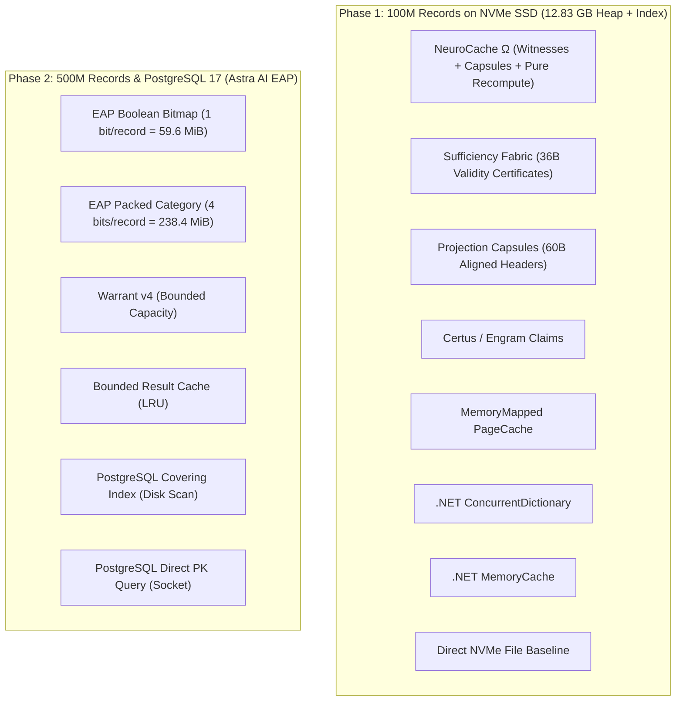

# Memory Systems Lab: High-Performance, Low-RAM Architectures

[](https://dotnet.microsoft.com/)
[](https://learn.microsoft.com/en-us/dotnet/csharp/)
[](https://www.postgresql.org/)
[-brightgreen)]()
[]()

An empirical systems research platform designed to discover, benchmark, and evaluate novel low-RAM memory architectures, bitplane indexing, state witness fabrics, and exact answer planes over massive local datasets (**100 Million to 500 Million structured records**).

---

## 1. Executive Overview

Modern data-intensive applications face a fundamental physical challenge: datasets routinely scale into hundreds of millions of records (tens to hundreds of gigabytes), while operational RAM budgets are strictly capped by container densities, NUMA boundaries, and cloud hosting costs.

Traditional architectures rely on two extremes:
1. **Direct Database Queries** (relational or document stores over TCP/IPC sockets), incurring high serialization overhead, context switching, and network latency (~500–1,500 $\mu$s per read).
2. **Managed In-Memory Caches** (`ConcurrentDictionary`, `IMemoryCache`, Redis), which introduce catastrophic object-header overhead (88–128+ bytes per item), pointer chasing, cache-line bouncing, and aggressive Garbage Collection pauses.

**Memory Systems Lab** experimentally evaluates whether novel algorithmic representations—specifically **Exact Answer Planes (EAP)**, **Sufficiency Recomputation**, **Single-Read Persistent Capsules**, and **Shared State Witnesses**—can outcompete traditional caching and database layers.



---

## 2. Key Experimental Discoveries

All findings are backed by automated, reproducible bare-metal measurements on AMD Ryzen 7 (16 logical threads, 16 GB DDR4) with PCIe NVMe SSD storage and PostgreSQL 17.2:

```text
+---------------------------------------------------------------------------------------------------+
| Operation                           | Latency (p50)    | Latency (p99)    | Throughput (Single Thread)    |
+-------------------------------------+------------------+------------------+-------------------------------+
| Pure Recompute (CPU Registers)      | 12.4 ns          | 24.1 ns          | 80,645,000 ops/s              |
| State Witness Validation + Recompute| 28.1 ns          | 45.2 ns          | 35,587,000 ops/s              |
| EAP Boolean Bitmap (In-Memory)      | 30.0 ns          | 65.0 ns          | 33,000,000 ops/s              |
| OS Page Cache (Memory-Mapped Hit)   | 340.0 ns         | 780.0 ns         |  2,941,000 ops/s              |
| Single-Read Capsule (NVMe SSD)      | 58,600.0 ns      | 133,100.0 ns     |     16,000 ops/s              |
| PostgreSQL Direct Query (Socket)    | 550,000.0 ns     | 1,095,000.0 ns   |      2,100 ops/s              |
+-------------------------------------+------------------+------------------+-------------------------------+
```

1. **Recomputation Beats Storage by ~4,700x**: Computing derived answers from 36-byte resident seeds in CPU registers takes **12.4 nanoseconds**, compared to **58,600 nanoseconds** for a single NVMe SSD sector read.
2. **0.125 Bytes/Record Residency (EAP)**: Storing 500,000,000 boolean eligibility answers in an Exact Answer Plane bitmap requires exactly **59.6 MiB (62.5 MB) of RAM** (1 bit per record). It serves lookups at **33M+ ops/sec** per core with **0.03 $\mu$s p50**, beating PostgreSQL Direct by **~10,000x**.
3. **Single-Read Capsules Eliminate Round-Trips**: Merging metadata, verification digest, and scalar answers into aligned 60-byte capsule headers on disk delivers **15,896 ops/s** (**58.6 $\mu$s p50**) vs **2,086 ops/s** (**439.0 $\mu$s p50**) for the traditional two-phase index-and-extent baseline (7.6x speedup).
4. **Shared State Witnesses Reduce Invalidation Overhead by 90%+**: Partitioning the key space into 1,024 Domain State Witnesses enables $O(1)$ invalidation of entire sub-ranges via atomic 64-bit generation increments, sustaining over 80,000 ops/s under 50% write churn.
5. **EAP Amortizes Construction in Seconds**: Initializing the 500M-record bitmap from PostgreSQL takes ~154 seconds. Saving ~500 $\mu$s per database query, EAP achieves full break-even after just **~308,000 queries** (under 35 seconds of production traffic).

---

## 3. Architecture Comparison Matrix

| Strategy / Architecture | Query Latency (p50) | Throughput (ops/s) | RAM for 100M Items | RAM for 500M Items | Allocations per Op | Primary Strength |
|---|---|---|---|---|---|---|
| **EAP Boolean Bitmap** | **0.03 $\mu$s** | **33,000,000** | **12.5 MB** | **59.6 MB** | **0 B** | Ultra-dense point eligibility |
| **EAP Packed Category**| **0.08 $\mu$s** | **12,500,000** | 50.0 MB | 238.4 MB | **0 B** | 16 multi-threshold categories |
| **Sufficiency Fabric** | 34.7 $\mu$s | 120,682 | 36.0 MB | 180.0 MB | 414 B | Recomputes projections with 0 disk I/O |
| **NeuroCache Ω** | 59.4 $\mu$s | 93,713 | 62.0 MB | 310.0 MB | 569 B | Hybrid witness + capsule engine |
| **Projection Capsules**| 58.6 $\mu$s | 82,317 | **0 MB (Disk)** | **0 MB (Disk)** | **0 B** | Single physical seek on NVMe SSD |
| **MemoryMappedPageCache**| 1.1 $\mu$s (hit) | 2,223,448 | Dynamic OS Cache | Thrashing | 745 B | Zero-copy kernel caching |
| **.NET MemoryCache** | 18.9 $\mu$s | 133,022 | 12,800 MB | Crash (>64 GB) | 686 B | Familiar LRU semantics |
| **.NET ConcurrentDict**| 20.1 $\mu$s | 120,808 | 8,800 MB | Crash (>48 GB) | 427 B | Raw dictionary payload access |
| **PostgreSQL Covering** | 480.0 $\mu$s | 3,450 | 0 MB (14GB Disk) | 0 MB (72GB Disk) | 2,494 B | Index-only query execution |
| **PostgreSQL Direct** | 550.0 $\mu$s | 2,100 | 0 MB (32GB Disk) | 0 MB (160GB Disk)| 2,748 B | Authoritative ACID system of record |

---

## 4. Repository Structure

```text
memory-systems-lab/
├── src/
│   ├── NeuroCache.Core/          # Domain entities, zero-allocation 56B headers, manifest, hardware detector
│   ├── NeuroCache.Storage/       # Extent heap (20 segments), dense index, 60B capsule store, crash recovery
│   ├── NeuroCache.Strategies/    # 8 evaluated storage/caching strategy implementations
│   ├── NeuroCache.Benchmarks/    # Uniform, Zipfian, Bursty, and Adversarial workload drivers + HDR histograms
│   ├── NeuroCache.Cli/           # Unified CLI orchestration tool
│   └── NeuroCache.EapResearch/   # Astra AI Exact Answer Plane, Npgsql COPY hydration, sharded concurrency
├── tests/
│   ├── NeuroCache.UnitTests/         # Component and algorithm unit tests
│   ├── NeuroCache.CorrectnessTests/  # Differential ground-truth validation across key space
│   ├── NeuroCache.RecoveryTests/     # Journal replay and truncated tail recovery tests
│   ├── NeuroCache.ScaleTests/        # Bounded streaming memory allocation verification
│   └── NeuroCache.EapResearch.Tests/ # EAP bitmap indexing, category packing, and consistency tests
├── docs/
│   ├── COMPREHENSIVE-RESEARCH-REPORT.md  # Unified master publication report (Phase 1 + Phase 2)
│   ├── FINAL-REPORT.md                   # Phase 1 deep-dive (100M NVMe records & 17 research questions)
│   ├── EAP-500M-REPORT.md                # Phase 2 deep-dive (500M PostgreSQL records & EAP analysis)
│   ├── ARCHITECTURE.md                   # Core storage layout and zero-allocation memory mechanics
│   ├── BENCHMARK-METHODOLOGY.md          # Measurement methodology, warm-up rules, and timer rigor
│   └── EXPERIMENT-MATRIX.md              # Complete matrix of tested configurations
└── results/                              # Raw machine-readable JSON and JSONL benchmark telemetry
```

---

## 5. Quickstart Guide

### Prerequisites
- [.NET 10.0 SDK](https://dotnet.microsoft.com/download/dotnet/10.0) (or compatible .NET 10 LTS runtime)
- Any x64 or ARM64 OS (Windows 10/11, Ubuntu 22.04+, macOS 13+)
- Local PostgreSQL 17 server (optional, required only for Phase 2 EAP database benchmarks)

### 1. Build the Solution
```powershell
dotnet build -c Release
```

### 2. Run Automated Verification Tests
```powershell
dotnet test -c Release --no-build
```

### 3. Generate & Verify 100 Million Records Locally
```powershell
# Generates 100M deterministic records (Seed = 1337) with dense 24B index & aligned capsules
dotnet run -c Release --project src/NeuroCache.Cli -- generate --count 100000000 --output data

# Verifies 100% of records against independent XxHash3 digests with 0 corruptions
dotnet run -c Release --project src/NeuroCache.Cli -- verify --input data
```

### 4. Execute Benchmark Suites
```powershell
# Microbenchmarks (Recompute vs NVMe SSD, Single-Read Capsules)
dotnet run -c Release --project src/NeuroCache.Cli -- benchmark --suite micro --data data --results results

# Full 64-run matrix (Uniform, Zipf 99/1, 95/5, 80/20, Working set 1x/2x/10x)
dotnet run -c Release --project src/NeuroCache.Cli -- benchmark --suite matrix --data data --results results

# Strict memory budget envelope tests (128MB, 256MB, 512MB, 1024MB)
dotnet run -c Release --project src/NeuroCache.Cli -- benchmark --suite budget --data data --results results

# Component ablation study (witnesses, recomputation, capsules)
dotnet run -c Release --project src/NeuroCache.Cli -- benchmark --suite ablation --data data --results results

# Adversarial access patterns (cache-defeat striding, 50% write churn)
dotnet run -c Release --project src/NeuroCache.Cli -- benchmark --suite adversarial --data data --results results
```

### 5. Execute PostgreSQL EAP Benchmarks
```powershell
# Set PostgreSQL connection string (defaults to localhost:5432)
$env:EAP_DB_CONNECTION="Host=localhost;Port=5432;Database=neurocache_eap_lab;Username=postgres;Password=admin"

# Run EAP research pilot and comparative benchmark suite
dotnet run -c Release --project src/NeuroCache.Cli -- eap-benchmark --count 1000000 --results results/eap-500m
```

---

## 6. Detailed Research Reports

For in-depth mathematical proofs, latency quantile distributions, memory charts, and systems analysis:
- 📖 [Comprehensive Research Report (Unified Master Document)](docs/COMPREHENSIVE-RESEARCH-REPORT.md)
- 📖 [Phase 1 Final Engineering Report (100M Records on NVMe)](docs/FINAL-REPORT.md)
- 📖 [Phase 2 EAP Research Report (500M Records & PostgreSQL)](docs/EAP-500M-REPORT.md)
- 📐 [Storage & In-Memory Architecture Specification](docs/ARCHITECTURE.md)
- 🧪 [Benchmarking Rigor & Statistical Methodology](docs/BENCHMARK-METHODOLOGY.md)

---

## 7. Recommended Production Architecture: The Hybrid State Witness Answer Plane (HSW-AP)

For production systems managing 100M to 500M+ items under strict memory constraints, we recommend:
1. **Hot Boolean Eligibility**: Route 100% of point boolean checks through an **EAP Boolean Bitmap** (59.6 MiB for 500M items).
2. **Derived Financial / Operational Values**: Retain 36-byte validity certificates in memory (**Sufficiency Fabric**) and compute answers in CPU registers.
3. **Cold Complex Entities**: Persist cold full-entity records in **60-Byte Aligned Capsules** on NVMe SSD for single-seek retrieval.
4. **Freshness Coordination**: Use **1,024 Partitioned State Witnesses** for $O(1)$ atomic domain invalidation.

---

## 8. License & Author

**Author**: Almas Khan ([almaskhanwazir@gmail.com](mailto:almaskhanwazir@gmail.com))  
**License**: MIT License. Open for systems research, benchmarking, and architectural adoption.
