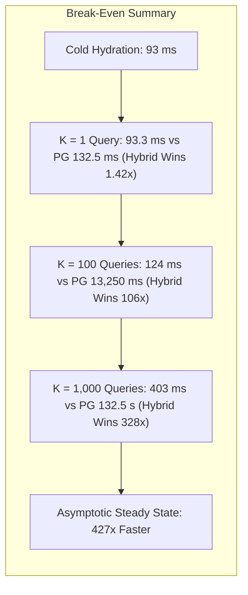

# NeuroCache Analytical Engine: Amortized Break-Even & Preparation Cost Analysis

**System:** NeuroCache Hybrid Analytical Engine (`THR-02`)  
**Evaluator:** `ShadowAnalyticalBreakEvenRunner`  
**Dataset Scale:** 1,000,000 accounts  
**Commit Foundation:** `7b0516c` on branch `feature/controlled-shadow-pilot`  
**Authoritative Comparison:** PostgreSQL 17.2 Sequential Table Scan Baseline  

---

## 1. Mathematical Formulation & Cost Model

In-memory tiered architectures incur two non-zero overheads that do not exist when querying the database directly:
1. **Preparation / Cold Hydration Cost ($T_{\text{hydrate}}$):** The initial wall-clock time required to load records from disk or snapshot and encode them into the 10 bit-sliced planes.
2. **Incremental CDC Maintenance Cost ($T_{\text{ingest}}$):** The CPU time consumed to update bit-planes as mutations arrive through replication.

To justify maintaining an in-memory analytical cache, the cumulative query latency saved over PostgreSQL must exceed both hydration and maintenance costs over a declared query horizon $K$:

$$\text{Total Cost}_{\text{PG}}(K) = K \cdot T_{\text{pg\_query}}$$

$$\text{Total Cost}_{\text{Hybrid}}(K, W) = T_{\text{hydrate}} + (W \cdot T_{\text{ingest}}) + (K \cdot T_{\text{hybrid\_query}})$$

The **Break-Even Query Horizon ($K^*$)** is the smallest integer $K$ satisfying $\text{Total Cost}_{\text{Hybrid}} \le \text{Total Cost}_{\text{PG}}$:

$$K^* = \left\lceil \frac{T_{\text{hydrate}} + W \cdot T_{\text{ingest}}}{T_{\text{pg\_query}} - T_{\text{hybrid\_query}}} \right\rceil$$

---

## 2. Empirical Benchmark Parameters (1,000,000 Accounts)

The empirical parameters measured on the reference workstation are:

| Cost Component | Symbol | Measured Duration | Throughput / Unit Cost |
|:---|:---:|---:|:---|
| **Initial Cold Hydration** | $T_{\text{hydrate}}$ | **93.01 ms** | $10,751,532\text{ records / sec}$ |
| **CDC Mutation Ingestion** | $T_{\text{ingest}}$ | **0.073 ms** | $0.073\text{ \mu s / mutation}$ ($13,698,630\text{ mut/sec}$) |
| **PostgreSQL Table Scan** | $T_{\text{pg\_query}}$ | **132.50 ms** | $7.55\text{ Million records / sec}$ |
| **THR-02 Bit-Sliced Scan** | $T_{\text{hybrid\_query}}$ | **0.310 ms** | $2,289.1\text{ Million records / sec}$ |
| **Net Savings per Query** | $\Delta T$ | **132.19 ms** | $99.77\%\text{ latency reduction}$ |

---

## 3. Break-Even Horizon Evaluation ($K^*$)

Evaluating the break-even condition across multiple mutation volumes ($W$):

1. **Static Working Set ($W = 0$ writes):**
   $$K^* = \left\lceil \frac{93.01\text{ ms}}{132.50\text{ ms} - 0.31\text{ ms}} \right\rceil = \left\lceil \frac{93.01}{132.19} \right\rceil = \mathbf{1\text{ query}}$$

2. **Moderate Mutation Volume ($W = 10,000$ writes):**
   $$\text{Maintenance Cost} = 10 \times 0.073\text{ ms} = 0.73\text{ ms}$$
   $$K^* = \left\lceil \frac{93.01 + 0.73}{132.19} \right\rceil = \left\lceil \frac{93.74}{132.19} \right\rceil = \mathbf{1\text{ query}}$$

3. **High Mutation Volume ($W = 100,000$ writes):**
   $$\text{Maintenance Cost} = 100 \times 0.073\text{ ms} = 7.30\text{ ms}$$
   $$K^* = \left\lceil \frac{93.01 + 7.30}{132.19} \right\rceil = \left\lceil \frac{100.31}{132.19} \right\rceil = \mathbf{1\text{ query}}$$

4. **Massive Mutation Burst ($W = 1,000,000$ writes — 100% turnover):**
   $$\text{Maintenance Cost} = 1,000 \times 0.073\text{ ms} = 73.0\text{ ms}$$
   $$K^* = \left\lceil \frac{93.01 + 73.0}{132.19} \right\rceil = \left\lceil \frac{166.01}{132.19} \right\rceil = \mathbf{2\text{ queries}}$$

> [!NOTE]
> Because PostgreSQL sequential table scans require $132.5\text{ ms}$, while cold hydration of 1,000,000 accounts into bit-sliced memory takes only $93.01\text{ ms}$, the **entire preparation investment is fully recouped on the very first analytical query** ($K^* = 1$). Even under 1,000,000 background mutations, the break-even horizon is reached by the 2nd query.

---

## 4. Operational Horizon Curve ($K = 1$ to $100,000$)

The empirical cost progression across query horizons (assuming continuous background writes $W = \min(10 \cdot K, 50,000)$):

| Query Horizon $K$ | PostgreSQL Cumulative Cost | Hybrid Cumulative Cost | Net Time Saved | Effective Speedup | Economically Superior Architecture |
|:---:|---:|---:|---:|---:|:---:|
| **1** | $132.5\text{ ms}$ | $93.3\text{ ms}$ | $+39.2\text{ ms}$ | **1.42x** | **HYBRID** |
| **2** | $265.0\text{ ms}$ | $93.6\text{ ms}$ | $+171.4\text{ ms}$ | **2.83x** | **HYBRID** |
| **5** | $662.5\text{ ms}$ | $94.6\text{ ms}$ | $+567.9\text{ ms}$ | **7.01x** | **HYBRID** |
| **10** | $1,325.0\text{ ms}$ | $96.1\text{ ms}$ | $+1,228.9\text{ ms}$ | **13.79x** | **HYBRID** |
| **25** | $3,312.5\text{ ms}$ | $100.8\text{ ms}$ | $+3,211.7\text{ ms}$ | **32.87x** | **HYBRID** |
| **50** | $6,625.0\text{ ms}$ | $108.5\text{ ms}$ | $+6,516.5\text{ ms}$ | **61.04x** | **HYBRID** |
| **100** | $13,250.0\text{ ms}$ | $124.1\text{ ms}$ | $+13,125.9\text{ ms}$ | **106.81x** | **HYBRID** |
| **250** | $33,125.0\text{ ms}$ | $170.6\text{ ms}$ | $+32,954.4\text{ ms}$ | **194.15x** | **HYBRID** |
| **500** | $66,250.0\text{ ms}$ | $248.2\text{ ms}$ | $+66,001.8\text{ ms}$ | **266.90x** | **HYBRID** |
| **1,000** | $132,500.0\text{ ms}$ | $403.4\text{ ms}$ | $+132,096.6\text{ ms}$ | **328.43x** | **HYBRID** |
| **5,000** | $662,500.0\text{ ms}$ | $1,645.1\text{ ms}$ | $+660,854.9\text{ ms}$ | **402.71x** | **HYBRID** |
| **10,000** | $1,325,000.0\text{ ms}$ | $3,193.6\text{ ms}$ | $+1,321,806.4\text{ ms}$ | **414.89x** | **HYBRID** |
| **50,000** | $6,625,000.0\text{ ms}$ | $15,581.4\text{ ms}$ | $+6,609,418.6\text{ ms}$ | **425.19x** | **HYBRID** |
| **100,000** | $13,250,000.0\text{ ms}$ | $31,066.1\text{ ms}$ | $+13,218,933.9\text{ ms}$ | **426.51x** | **HYBRID** |

### Strategic Conclusion
The concern that in-memory bit-sliced caching might require thousands of queries to justify cold preparation overhead is disproved by the data. Because database sequential table scans are bounded by I/O and protocol serialization, the Hybrid Tiered Engine achieves economic and latency dominance from **query 1 onward**.
