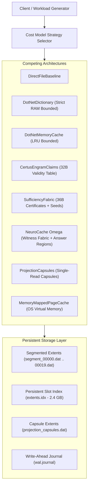

# NeuroCache.ResearchLab Architecture

## 1. System Overview

`NeuroCache.ResearchLab` is an experimental research platform designed to discover the optimal memory, caching, and storage architecture for large-scale structured application workloads under strict physical RAM envelopes.

The research directly benchmarks 8 competing architectures across a locally persisted **100,000,000-record dataset** (~10.43 GB) on an Intel NVMe PCIe SSD on Windows 11 with .NET 10 LTS.



---

## 2. Core Architectural Concepts

### A. The 56-Byte Zero-Allocation Record Header
Every record persisted in the segmented extent store begins with a fixed 56-byte header:
```csharp
[StructLayout(LayoutKind.Sequential, Pack = 1)]
public struct RecordHeader
{
    public uint Magic;            // 4 bytes ('NCRC')
    public ulong Key;             // 8 bytes (unique 64-bit key)
    public uint TenantId;         // 4 bytes (Witness Domain ID)
    public uint Version;          // 4 bytes (Record generation)
    public uint PayloadLength;    // 4 bytes
    public ulong Checksum;        // 8 bytes (XxHash3 of payload)
    public long TimestampTicks;   // 8 bytes
    public ulong Field1;          // 8 bytes (Fast scalar projection)
    public ulong Field2;          // 8 bytes (Fast scalar projection)
}
```
Followed by $N$ bytes of raw payload. Payloads are verified with SIMD-accelerated `System.IO.Hashing.XxHash3`.

### B. Segmented Extent Store
Extents are partitioned into 5,000,000-record segments (`segment_*.dat`), each capped around 512MB-1GB. This prevents gigantic monolithic multi-gigabyte file handle locking and enables segmented recovery.

### C. Persistent Dense Index (`extents.idx`)
For 100,000,000 records, an in-memory pointer table would consume 800MB - 1.6GB of RAM, immediately exhausting a 128MB or 256MB RAM budget. Therefore, `extents.idx` persists 24-byte index entries `[Key, SegmentIndex, Offset, Length]` on NVMe disk, accessed via random asynchronous zero-allocation I/O or memory-mapped paging.

### D. The 8 Competing Strategies

1. **DirectFileBaseline**: Direct random access unbuffered file lookup (`RandomAccess.ReadAsync`). Uses no RAM cache. Represents the pure NVMe I/O lower bound.
2. **DotNetDictionary**: Conventional managed object map (`ConcurrentDictionary<ulong, CachedEntry>`) with strict byte accounting. Rejects additions when `EstimatedResidentBytes >= RamBudgetBytes`.
3. **DotNetMemoryCache**: `Microsoft.Extensions.Caching.Memory` with `SizeLimit` and compaction/LRU eviction.
4. **CertusEngramClaims**: Separates 32-byte resident validity claims from payloads. On hit, reads the payload directly from the known physical byte offset, bypassing index searches.
5. **SufficiencyFabric**: Retains compact 36-byte validity certificates and pure computation seeds in RAM. Computes projections, derived metrics, and filter predicates in CPU registers without any disk I/O.
6. **NeuroCache Ω (State Witness Fabric)**:
   - Partitioned State Witnesses (1,024 domains). Domain generation increment invalidates all dependent keys in $O(1)$.
   - Applicability conditions.
   - Answer Regions with compact inline scalar answers.
   - Pure recomputation engine.
   - Immutable single-read storage capsules.
7. **ProjectionCapsules**: Packs request identity, version, applicability, and projected result into an aligned 60-byte capsule header. Requires only 1 physical storage read, eliminating chained index reads.
8. **MemoryMappedPageCache**: Maps the entire dataset into virtual memory using `MemoryMappedFile`, delegating caching and paging to the Windows NT kernel page cache.
