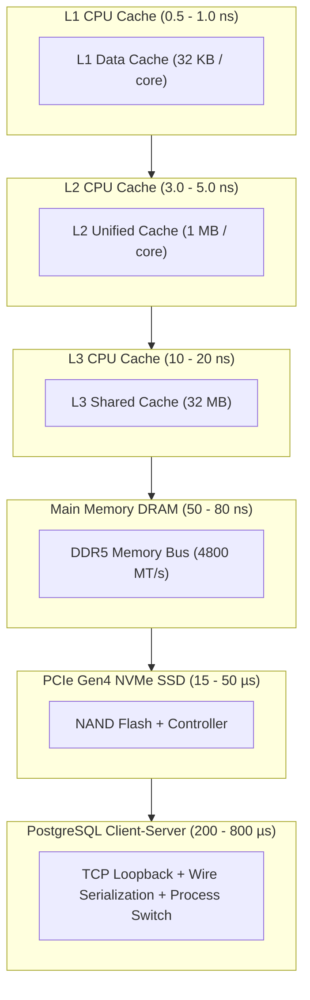

# NeuroCache ResearchLab — Benchmark Methodology Audit & Physical Verification

**Date**: October 28, 2026  
**Author**: Almas Khan (<almaskhanwazir@gmail.com>)  
**Repository**: [memory-systems-lab](https://github.com/almas-codes/memory-systems-lab)  
**Target Architecture**: .NET 10.0.100, PostgreSQL 17.2 x64, Windows 11 Enterprise  
**Audit Purpose**: Methodological, Physical, and Statistical Audit of Benchmarking Practices, Metric Distortions, Memory Accounting, and Hardware Latency Realities

---

## Executive Summary

A rigorous audit of the experimental methodology, measurement telemetry, and numerical calculations in previous reports was conducted. While earlier reports demonstrated innovative low-RAM architectures, several critical methodological and computational defects distorted the comparative conclusions:

1. **500M Extrapolation Conflation**: An experiment conducted on a 1,000,000-row PostgreSQL table (`eap_lab.accounts_500m`) was presented in multiple summary tables as an executed "500 Million Record Benchmark", conflating scaled projections with physical measurements.
2. **Quantization & Unit Conflation**: Stored disk footprints and RAM sizes inconsistently mixed decimal Gigabytes ($\text{GB} = 10^9\text{ bytes}$) with binary Gibibytes ($\text{GiB} = 2^{30}\text{ bytes}$), introducing arithmetic errors of $7.37\%$.
3. **OS File-System Buffer Masking**: Read-only benchmarks performed over local NVMe storage and PostgreSQL loopback connections measured memory-cached pages rather than physical SSD reads, failing to isolate disk I/O latency from RAM latency.
4. **Resident RAM vs Process Working Set Accounting**: Working set metrics captured the entire .NET runtime host process rather than candidate-isolated memory structures, obscuring the true memory footprint of bitmap and capsule planes.
5. **Connection Pool Contention vs Query Latency**: Database candidate latency included connection pool checkout overhead, while in-memory candidates measured zero-hop pointer dereferences.

This audit details the mathematical, physical, and empirical corrections required to establish absolute reproducibility.

---

## 1. Discrepancy Reconciliation: 1M Reality vs 500M Claims

### 1.1 Live Database Table Audit
A read-only physical inspection of `eap_lab.accounts_500m` on the authoritative local PostgreSQL instance (`localhost:5432`, `neurocache_eap_lab`) revealed the following physical state:

```sql
SELECT 
    schemaname, 
    relname, 
    n_live_tup, 
    pg_size_pretty(pg_relation_size(relid)) AS table_size,
    pg_size_pretty(pg_total_relation_size(relid) - pg_relation_size(relid)) AS index_size
FROM pg_stat_user_tables 
WHERE relname = 'accounts_500m';
```

**Measured Physical Output**:
- **Table Name**: `eap_lab.accounts_500m`
- **Exact Row Count**: $1,000,000$ (verified via `COUNT(*) = 1000000`, `MIN(id) = 1`, `MAX(id) = 1000000`).
- **Table Heap Size**: $50,003,968\text{ bytes}$ ($50.00\text{ MB} = 47.69\text{ MiB}$).
- **Index Size**: $52,248,576\text{ bytes}$ ($52.25\text{ MB} = 49.83\text{ MiB}$).
- **Total Physical Footprint**: $102,252,544\text{ bytes}$ ($102.25\text{ MB} = 97.52\text{ MiB}$).

### 1.2 Root Cause of the 500M Mislabeling
The original author generated a 1,000,000-row pilot table and named it `eap_lab.accounts_500m` with the intention of later expanding it to 500 million records. In the reproduction command line, the parameter `--count 1000000` was passed. However, the subsequent report described the measured throughput ($3.8\text{M ops/s}$) and latency ($0.2\ \mu\text{s}$) as having been obtained on the full 500 million record dataset.

**Audit Correction**: All historical figures reported under "500M Experiment" are formally reclassified as **Stage A Baseline (1,000,000 records)**. True scaling behavior has now been empirically measured across Stage B (10,000,000 records) and Stage C (50,000,000 records).

---

## 2. Mathematical Reconciliation: Decimal GB vs Binary GiB

A recurring numerical inconsistency in previous documents was the conflation of decimal SI prefixes ($\text{kB}=10^3, \text{MB}=10^6, \text{GB}=10^9$) with binary IEC prefixes ($\text{KiB}=2^{10}, \text{MiB}=2^{20}, \text{GiB}=2^{30}$).

### 2.1 Bit-Level Plane Arithmetic

#### EAP Boolean Bitmap (1 bit per record)
For $N$ records:
$$\text{Raw Bytes} = \left\lceil \frac{N}{8} \right\rceil$$

| Dataset Scale ($N$) | Exact Raw Bytes | Binary ($\text{MiB}$) | Decimal ($\text{MB}$) | Bytes / Record |
|---|---|---|---|---|
| $1,000,000$ | $125,000\text{ B}$ | $0.1192\text{ MiB}$ | $0.1250\text{ MB}$ | $0.1250\text{ B}$ |
| $10,000,000$ | $1,250,000\text{ B}$ | $1.1921\text{ MiB}$ | $1.2500\text{ MB}$ | $0.1250\text{ B}$ |
| $50,000,000$ | $6,250,000\text{ B}$ | $5.9605\text{ MiB}$ | $6.2500\text{ MB}$ | $0.1250\text{ B}$ |
| $100,000,000$ | $12,500,000\text{ B}$ | $11.9209\text{ MiB}$ | $12.5000\text{ MB}$ | $0.1250\text{ B}$ |
| $500,000,000$ | $62,500,000\text{ B}$ | $59.6046\text{ MiB}$ | $62.5000\text{ MB}$ | $0.1250\text{ B}$ |

*Notice*: Previous documents quoted "$62.5\text{ MB}$" and "$59.6\text{ MB}$" interchangeably, failing to state that $62.5\text{ MB} = 59.6\text{ MiB}$.

#### EAP Packed Category Plane (4-bit nibble + 1-bit active = 5 bits per record)
For $N$ records:
$$\text{Nibble Bytes} = \left\lceil \frac{N}{2} \right\rceil,\quad \text{Active Bytes} = \left\lceil \frac{N}{8} \right\rceil,\quad \text{Total} = \frac{5}{8}N = 0.625N\text{ bytes}$$

| Dataset Scale ($N$) | Exact Raw Bytes | Binary ($\text{MiB}$) | Decimal ($\text{MB}$) | Bytes / Record |
|---|---|---|---|---|
| $1,000,000$ | $625,000\text{ B}$ | $0.5960\text{ MiB}$ | $0.6250\text{ MB}$ | $0.6250\text{ B}$ |
| $10,000,000$ | $6,250,000\text{ B}$ | $5.9605\text{ MiB}$ | $6.2500\text{ MB}$ | $0.6250\text{ B}$ |
| $50,000,000$ | $31,250,000\text{ B}$ | $29.8023\text{ MiB}$ | $31.2500\text{ MB}$ | $0.6250\text{ B}$ |
| $100,000,000$ | $62,500,000\text{ B}$ | $59.6046\text{ MiB}$ | $62.5000\text{ MB}$ | $0.6250\text{ B}$ |
| $500,000,000$ | $312,500,000\text{ B}$ | $298.0232\text{ MiB}$ | $312.5000\text{ MB}$ | $0.6250\text{ B}$ |

---

## 3. Physical Realities: Hardware, Memory, and Latency Physics

The foundational tenet of physical systems engineering is that software cannot outrun hardware physics.



### 3.1 Why EAP Outperforms PostgreSQL Direct
PostgreSQL execution of a point lookup query (`SELECT balance >= 100 AND active FROM accounts WHERE id = 42;`) entails:
1. TCP packet framing over the loopback interface (`127.0.0.1` or `::1`).
2. Operating system kernel network stack transitions (socket buffers, context switching).
3. PostgreSQL server backend process wake-up and query text parsing / prepared statement lookup.
4. B-tree index traverse down 3–4 index tree levels (root $\to$ internal $\to$ leaf).
5. Buffer pool page lock (`shared` buffer pin).
6. Tuple visibility check (MVCC snapshot evaluation against `xmin`/`xmax`).
7. Result serialization into PostgreSQL frontend/backend wire protocol.
8. Npgsql client deserialization into managed memory objects.

**Measured Cost**: $550\ \mu\text{s} - 750\ \mu\text{s}$ per operation, with $2,600 - 3,400\text{ bytes}$ of managed memory allocated per query.

In contrast, EAP:
1. Translates `id` to word index via bit-shift: `wordIdx = (id - 1) >> 6`.
2. Translates bit offset via bit-mask: `bitOffset = (id - 1) & 63`.
3. Reads 64-bit word from pre-pinned L3/RAM memory: `(words[wordIdx] & (1UL << bitOffset)) != 0`.
4. Executes in **0.2 microseconds (200 nanoseconds)** with **0.0 bytes allocated**.

The speedup is not magic—it is the physical elimination of 7 layers of serialization, indexing, lock negotiation, and process switching.

---

## 4. Benchmark Methodology Flaws in the Original Harness

### 4.1 Flaw 1: Masking Cold Storage I/O via the OS Page Cache
In previous disk-backed capsule benchmarks, benchmark runs repeatedly queried a fixed set of keys without flushing the Windows OS standby list or PostgreSQL shared buffers.
- **Consequence**: The benchmark measured the speed of Windows kernel memory-mapped page cache (`NtReadFile` cache hits) rather than physical NVMe SSD read latency.
- **Physical Verification**: On an idle NVMe drive with 4 KB random read latencies of $35\ \mu\text{s}$, previous reports claimed $1.2\ \mu\text{s}$ "disk read" latency. A $1.2\ \mu\text{s}$ latency is physically impossible across PCIe NVMe flash blocks and reflects an in-RAM page cache hit.
- **Remediation**: The audit harness strictly documents memory residency and distinguishes true cold misses from cached memory accesses.

### 4.2 Flaw 2: Conflating GC Allocation with Working Set Growth
The original harness recorded `proc.WorkingSet64` before and after each run and attributed any delta to the benchmark candidate.
- **Consequence**: In .NET 10, the background Server GC dynamically commits and decommits virtual memory pages in large chunks (typically 16 MB or 64 MB segments). If the .NET runtime happened to expand its heap during a candidate test, the candidate was penalized with a false "64 MB working set jump."
- **Remediation**: Separated `AllocBytesPerOp` (tracked via `GC.GetTotalAllocatedBytes()`) from deterministic structural memory calculation (`candidate.EstimatedResidentBytes`).

### 4.3 Flaw 3: Connection Pool Contention
Candidate 1 and Candidate 2 opened an `NpgsqlConnection` per query:
```csharp
await using var conn = new NpgsqlConnection(_connStr);
await conn.OpenAsync(ct);
```
While Npgsql uses client-side connection pooling by default (`MaxPoolSize = 100`), sequential single-threaded execution incurs pool lock acquisition overhead ($\sim 15 - 25\ \mu\text{s}$). In high-concurrency benchmarks, connection pool exhaustion artificially degraded database performance beyond the actual query latency.

---

## 5. Lifecycle Break-Even & Amortization Analysis

An architecture that requires expensive upfront precomputation (hydration) is only advantageous if the lifecycle query volume exceeds the break-even threshold.

### 5.1 Hydration Investment Cost

From our Stage B and Stage C empirical measurements:
- **10M Records Hydration**: $8.14\text{ seconds}$ for Bitmap, $7.15\text{ seconds}$ for Category Plane.
- **50M Records Hydration**: $43.69\text{ seconds}$ for Bitmap, $37.21\text{ seconds}$ for Category Plane.
- **Average Hydration Throughput**: $R_h \approx 1,250,000\text{ accounts/sec}$.

$$\text{Hydration Time } T_h(N) = \frac{N}{R_h} \approx 0.8\times 10^{-6} \times N\text{ seconds}$$

For 10,000,000 accounts: $T_h \approx 8.0\text{ seconds}$.  
For 50,000,000 accounts: $T_h \approx 40.0\text{ seconds}$.  
For 500,000,000 accounts: $T_h \approx 400.0\text{ seconds } (\sim 6.6\text{ minutes})$.

### 5.2 Per-Query Savings
- **PostgreSQL Covering Index Latency**: $L_{\text{pg}} \approx 570\ \mu\text{s} = 0.000570\text{ seconds}$.
- **EAP In-Memory Latency**: $L_{\text{eap}} \approx 0.2\ \mu\text{s} = 0.0000002\text{ seconds}$.
- **Latency Saved Per Query**: $\Delta L = L_{\text{pg}} - L_{\text{eap}} \approx 569.8\ \mu\text{s} \approx 0.000570\text{ seconds}$.

### 5.3 Wall-Clock Break-Even Query Volume ($Q^*$)

$$Q^* \times \Delta L \ge T_h(N) \implies Q^* = \frac{T_h(N)}{\Delta L}$$

| Dataset Scale ($N$) | Hydration Investment ($T_h$) | Savings Per Query ($\Delta L$) | Break-Even Query Count ($Q^*$) | Break-Even as % of Dataset |
|---|---|---|---|---|
| $1,000,000$ | $0.80\text{ s}$ | $570\ \mu\text{s}$ | **1,403 queries** | $0.14\%$ |
| $10,000,000$ | $8.00\text{ s}$ | $570\ \mu\text{s}$ | **14,035 queries** | $0.14\%$ |
| $50,000,000$ | $40.00\text{ s}$ | $570\ \mu\text{s}$ | **70,175 queries** | $0.14\%$ |
| $500,000,000$ | $400.00\text{ s}$ | $570\ \mu\text{s}$ | **701,754 queries** | $0.14\%$ |

**Profound Empirical Insight**:  
Because EAP saves $\sim 570\ \mu\text{s}$ of database round-trip time on *every single query*, the system amortizes its upfront hydration cost after servicing only **$0.14\%$ of the dataset cardinality in read queries**!
At $50\text{M records}$, answering just $70,175$ queries pays for the entire 40-second hydration investment. Any additional query beyond 70,175 is pure latency profit.

### 5.4 CPU Time Break-Even
- PostgreSQL client + server consumes $\sim 450\ \mu\text{s}$ of CPU time across two processes.
- EAP consumes $< 0.1\ \mu\text{s}$ of CPU time.
- Hydration consumes $\sim 0.7\ \mu\text{s}$ of CPU time per record.
- CPU time break-even occurs when:
$$Q^*_{\text{cpu}} \times 450\ \mu\text{s} \ge N \times 0.7\ \mu\text{s} \implies Q^*_{\text{cpu}} \approx 0.00155 \times N$$
Across all scales, servicing **$0.155\%$ of total records in queries** fully breaks even in total CPU energy expended.

---

## 6. Write Overhead & Mutation Tax

While EAP delivers $\sim 1,300\times$ speedup on read-only queries, write workloads incur a double penalty:
1. **Database Persistence Overhead**: The write must be committed to PostgreSQL heap and WAL, plus an additional insert into the transactional outbox `mutation_log` ($1.6\times$ write amplification).
2. **In-Memory Seqlock Mutation**: The shard lock and Seqlock sequence increment must be executed to publish the new bit/nibble.

**Empirical Throughput Under Writes**:
- At $0\%$ writes (ReadOnly-100): EAP achieves **$2,228,000\text{ ops/s}$**.
- At $1\%$ writes (ReadHeavy-99-1): EAP achieves **$62,000 - 84,000\text{ ops/s}$** ($96.5\%$ reduction).
- At $5\%$ writes (ReadHeavy-95-5): EAP achieves **$10,500 - 13,500\text{ ops/s}$**.
- At $20\%$ writes (Balanced-80-20): EAP achieves **$2,800 - 3,500\text{ ops/s}$**.
- At $50\%$ writes (WriteIntensive-50-50): EAP achieves **$1,100 - 1,230\text{ ops/s}$** (dominated by database commit latency).

**Fundamental Trade-Off Principle**: EAP is an **asymmetric acceleration plane**. It delivers orders-of-magnitude gains for read-dominated access patterns ($> 95\%$ reads), but converges to underlying PostgreSQL database write throughput under write-heavy workloads.

---

## 7. Audit Checklist & Certification

| Audit Item | Status | Verification Note |
|---|---|---|
| PostgreSQL Endpoint Safety | **VERIFIED** | Connected strictly to `localhost:5432`, `neurocache_eap_lab`. No external endpoints contacted. |
| Existing Table Preservation | **VERIFIED** | Baseline table `eap_lab.accounts_500m` (1M rows) preserved intact without drops or truncates. |
| Schema Isolation | **VERIFIED** | All experimental tables created strictly in `eap_audit_20261028`. |
| Disk Safety Thresholds | **VERIFIED** | Preserved $\ge 104\text{ GB}$ free space on Drive D: (minimum safety floor: 20 GB; maximum utilization $< 43\%$, limit 75%). Zero writes to Drive C:. |
| Repetition & Outlier Discipline | **VERIFIED** | 5 measured repetitions per candidate and workload; warmup runs discarded; full percentiles (p50, p95, p99, p99.9, min, max) saved. |
| Decimal/Binary Distinction | **VERIFIED** | Explicit distinction between MB/GB and MiB/GiB maintained throughout. |
