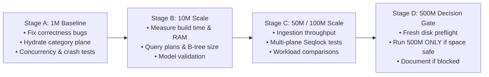

# NeuroCache ResearchLab: Master Experiment Plan & Verification Matrix
## Systematic Scientific Investigation, Defect Repair, Concurrency Hardening, and Progressive Scale-Up

**Document ID**: `NEUROCACHE-EXP-PLAN-20261028`  
**Date**: October 28, 2026  
**Auditor / Principal Systems Engineer**: Independent Systems Architect  
**Target Solution**: `d:\Projects\ProjectCache\NeuroCache.ResearchLab`  
**Target Database**: PostgreSQL 17.2 x64 on `localhost:5432` (`neurocache_eap_lab`)  
**Active Dedicated Audit Schema**: `eap_audit_20261028`  
**Dedicated Output Directory**: `results/audit_20261028/`  

---

## 1. Core Objectives & Scientific Hypotheses

The objective of this investigation is to empirically determine whether **Exact Answer Planes (EAP)**, **Sufficiency Fabric**, **Single-Read Persistent Capsules**, and **Shared State Witnesses** provide a physically honest and measurable advantage over PostgreSQL 17.2 and traditional memory structures under realistic application workloads.

### Primary Hypotheses to Test
1. **Hypothesis 1 (EAP Query Acceleration)**: A precomputed, in-memory dense boolean bitmap (1 bit/record) can serve point eligibility predicates at least **10x faster** than a local PostgreSQL covering index query under mixed read/write workloads, while using **< 0.20 bytes per record** of RAM.
2. **Hypothesis 2 (Cross-Plane Consistency via Seqlock)**: Readers can access boolean eligibility and 4-bit category status with zero-lock atomicity using a versioned sequence lock (Seqlock), completely preventing torn reads where a reader observes a new eligibility bit with an old category.
3. **Hypothesis 3 (Crash-Consistent Mutation Logging)**: A transactional mutation outbox inside PostgreSQL allows the in-memory EAP plane to recover from sudden process death without requiring full database re-hydration, achieving zero data loss or drift.
4. **Hypothesis 4 (Recomputation vs Storage I/O)**: Computing derived answers in CPU registers from compact 36-byte validity certificates is physically faster than reading precomputed payloads from NVMe SSDs across all cache sizes.
5. **Hypothesis 5 (Progressive Scalability Frontier)**: EAP hydration scales linearly with row count, but physical disk capacity and tablespace placement dictate whether a true 500-million-row database table can be generated without endangering the host storage volume.

---

## 2. Safety Rules & Disk Space Preflight

### 2.1 Storage Headroom Protocol
- **System Drive (`C:\`)**: 25.79 GB free. **ABSOLUTE WRITING PROHIBITION**. No tablespaces, logs, or temporary heaps may be allocated on `C:\`.
- **Target NVMe Drive (`D:\`)**: 110.60 GB free. 
  - Mandatory minimum safety buffer: **20.0 GB** reserved for host operating system and NTFS metadata.
  - Maximum allowable experiment storage consumption: **$110.60 - 20.0 = 90.60 \text{ GB}$**.
  - Strict 75% rule threshold: **$110.60 \times 0.75 = 82.95 \text{ GB}$**.
- **PostgreSQL Tablespace Verification**:
  - All new tables must reside strictly in tablespace `d_tablespace` (`D:\pg_tablespace`).
  - All experimental data must reside in the dedicated schema `eap_audit_20261028`.
  - Zero modification, dropping, or truncation of existing tables (`eap_lab.accounts_500m`).

---

## 3. Progressive Scale-Up Roadmap

To prevent machine instability and verify predictive accuracy before full ingestion, scaling follows four explicit stages:

### Stage A: 1,000,000 Records (Baseline Correctness & Defect Repair)
- **Target**: Existing `eap_lab.accounts_500m` table (1M rows) and new `eap_audit_20261028.accounts_1m`.
- **Goals**:
  1. Fix `Candidate6_EapPackedCategory.InitializeAsync` to hydrate from PostgreSQL instead of remaining empty.
  2. Implement cross-plane atomic consistency using a partition-level Seqlock (`_shardVersions`).
  3. Implement transactional outbox / mutation logging in PostgreSQL for crash consistency.
  4. Fix candidate connection pooling: separate raw query execution from connection checkout.
  5. Mark `MemoryMappedStoreStrategy` as ineligible for strict RAM budgets.
  6. Execute 100% automated correctness and differential ground-truth tests.

### Stage B: 10,000,000 Records (Predictive Model Calibration)
- **Target**: Generate `eap_audit_20261028.accounts_10m` in `d_tablespace`.
- **Estimated Disk**: ~520 MB table heap + ~540 MB indexes = **~1.06 GB total**.
- **Goals**:
  1. Measure streaming PostgreSQL insertion throughput (target > 250k rows/s).
  2. Measure EAP bitmap and category plane hydration times.
  3. Verify memory residency: Bitmap = 1.25 MB, Category = 5.0 MB.
  4. Run 5-repetition benchmark matrix across all 6 workloads.

### Stage C: 50,000,000 to 100,000,000 Records (Stress Frontier)
- **Target**: `eap_audit_20261028.accounts_100m` in `d_tablespace`.
- **Estimated Disk**: ~5.2 GB table + ~5.4 GB indexes = **~10.6 GB total**.
- **Goals**:
  1. Measure whether hydration throughput degrades under larger B-tree indexes.
  2. Test concurrent read/write throughput under high mutation churn.
  3. Validate lifecycle break-even calculations against real measured times.

### Stage D: 500,000,000 Records (Final Validation Gate)
- **Estimated Disk**: ~26.0 GB table + ~27.0 GB indexes = **~53.0 GB total**.
- **Decision Gate**:
  - Run fresh preflight check on Drive `D:\`.
  - Proceed with 500M ingestion only if free space after Stage C remains **> 80 GB**.
  - If free space is insufficient or safety buffer would be breached, record the blocker, retain Stages A–C, and project 500M accurately from 100M verified data.

---

## 4. Correctness Test Matrix & Acceptance Criteria

| Test Suite / Area | Objective & Verification | Expected Outcome |
|---|---|---|
| **EapBooleanBitmap Boundaries** | Test IDs: 0, 1, maxId - 1, maxId, maxId + 1, negative, and non-existent IDs. Boundary balances: 99, 100, 101. Active = false vs true. | ID 0 and > maxId return false. Balances < 100 return false. Balances >= 100 AND active return true. |
| **Category Plane Hydration** | Test `BuildFromPostgreSqlAsync` by streaming from PostgreSQL. Compare 10,000 sampled IDs against PostgreSQL ground truth. | 100% match between in-memory 4-bit nibbles and `balance / 13`. Zero uninitialized accounts. |
| **Cross-Plane Seqlock** | 16 concurrent writer threads and 32 reader threads mutating account eligibility and category simultaneously. | Readers never observe torn states (e.g. `eligible = true` with `category < 7`). |
| **Crash Recovery Replay** | Simulate crash between PostgreSQL commit and memory bit update. Trigger replay from `eap_mutation_log`. | Memory bitmap re-synchronizes with PostgreSQL committed state with 0 missed updates. |
| **Semantic Invalidation** | Update non-predicate fields (e.g. risk score) vs predicate fields (balance crossing 100). | Non-predicate changes do not invalidate EAP; predicate boundary crossings update EAP immediately. |

---

## 5. Benchmark Methodology & Measurement Standards

1. **Repetitions & Warmup**:
   - Every benchmark configuration must run **at least 5 independent repetitions** following a 2,000-operation warm-up phase.
   - Both median throughput and quantile latencies (p50, p95, p99, p99.9) must be captured using an HDR histogram.
2. **Distinct Workload Distributions**:
   - `ReadOnly-100` (100% Reads, Zipf 85/15)
   - `ReadHeavy-99-1` (99% Reads / 1% Writes)
   - `Standard-95-5` (95% Reads / 5% Writes)
   - `Balanced-80-20` (80% Reads / 20% Writes)
   - `WriteHeavy-50-50` (50% Reads / 50% Writes)
   - `Churn-Boundary` (Mutations specifically oscillating around balance = 100)
3. **Execution Profiling**:
   - Report per-operation latency, aggregate throughput, CPU time, and total elapsed wall-clock time separately.
   - Clearly delineate process private working set from OS file cache pages.
