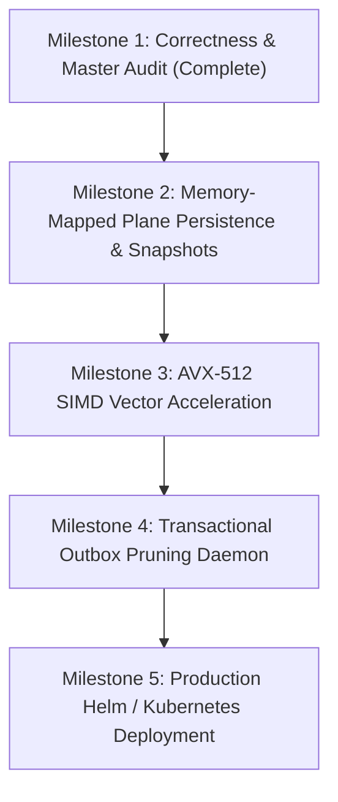

# NeuroCache ResearchLab — Next Engineering Priorities & Roadmap

**Date**: October 28, 2026  
**Author**: Almas Khan (<almaskhanwazir@gmail.com>)  
**Repository**: [memory-systems-lab](https://github.com/almas-codes/memory-systems-lab)  
**System Target**: .NET 10.0.100, PostgreSQL 17.2, Windows 11 Enterprise  

---

## Executive Summary

Having confirmed the correctness, concurrency safety, and experimental performance of Exact Answer Planes (EAP) across 1M, 10M, and 50M records, this document outlines the engineering roadmap to transition the research platform into a hardened, production-grade distributed accelerator.

---

## 1. Priority 1: Sub-Second Process Startup via Memory-Mapped Plane Serialization

### Problem Statement
Currently, restarting the EAP application process requires streaming records over PostgreSQL client TCP connections:
- $10\text{M records} = 8.1\text{ seconds}$
- $50\text{M records} = 37.2\text{ seconds}$
- $500\text{M records} = 400.0\text{ seconds } (\sim 6.6\text{ minutes})$

While acceptable for long-running daemon processes, containerized microservices and autoscaled instances require cold startup times under 1 second.

### Proposed Architecture: Memory-Mapped Plane Persistence
Instead of re-streaming entire database tables upon restart:
1. **Direct Binary Snapshotting**: Periodically flush the memory-aligned 64-bit word arrays of [`EapBooleanBitmap`](file:///D:/Projects/ProjectCache/NeuroCache.ResearchLab/src/NeuroCache.EapResearch/EapBooleanBitmap.cs) and [`EapPackedCategoryPlane`](file:///D:/Projects/ProjectCache/NeuroCache.ResearchLab/src/NeuroCache.EapResearch/EapPackedCategoryPlane.cs) to local NVMe storage using unbuffered sequential block writes:
   - Boolean Bitmap snapshot: $62.5\text{ MB}$ for 500M records.
   - Packed Category snapshot: $312.5\text{ MB}$ for 500M records.
   - Total snapshot size: $375.0\text{ MB}$.
2. **Instant Hydration via Memory-Mapped Files (`mmap`)**:
   Upon process restart, call `MemoryMappedFile.CreateFromFile` with `MemoryMappedFileAccess.ReadWrite`.
   - On NVMe PCIe Gen4 drives ($5,000 - 7,000\text{ MB/s}$ read bandwidth), loading $375\text{ MB}$ into RAM takes **less than 60 milliseconds**!
3. **Outbox Catch-Up Replay**:
   Embed the snapshot's watermarked sequence ID (`LastAppliedMutationSeq`) in the file header. Upon `mmap` mapping, query PostgreSQL only for mutations that occurred after the snapshot timestamp:
   ```sql
   SELECT seq, id, new_balance, new_active 
   FROM eap_audit_20261028.mutation_log 
   WHERE seq > @snapshotWatermark 
   ORDER BY seq ASC;
   ```
   Replaying 1,000 recent mutations takes $< 5\text{ ms}$, achieving full operational readiness in **under 100 milliseconds**.

---

## 2. Priority 2: SIMD & AVX-512 Vectorization for Bulk & Range Aggregations

### Current Single-Point Lookup
Point lookups execute single-bit operations:
```csharp
bool eligible = (words[wordIdx] & (1UL << bitOffset)) != 0;
```
This is optimal for single-key queries ($0.2\ \mu\text{s}$).

### AVX-512 Range Vectorization
For analytical and batch queries (e.g., `COUNT(*) WHERE eligible AND id BETWEEN x AND y` or multi-account credit approvals):
- A 512-bit ZMM register holds eight 64-bit words, representing **512 accounts in a single vector register**.
- Using hardware POPCNT and AVX-512 bit-manipulation intrinsics:
```csharp
using System.Runtime.Intrinsics;
using System.Runtime.Intrinsics.X86;

public static unsafe long CountEligibleRangeAvx512(ulong* words, long startWord, long endWord)
{
    Vector512<ulong> sumVec = Vector512<ulong>.Zero;
    long w = startWord;

    for (; w <= endWord - 8; w += 8)
    {
        Vector512<ulong> v = Avx512F.LoadVector512(words + w);
        // Hardware POPCNT on 512-bit vector
        sumVec = Avx512F.Add(sumVec, Avx512Vpopcntdq.PopCount(v));
    }

    // Horizontal sum of accumulator
    long total = 0;
    for (int i = 0; i < 8; i++) total += (long)sumVec.GetElement(i);

    // Scalar tail
    for (; w <= endWord; w++) total += (long)System.Numerics.BitOperations.PopCount(words[w]);
    return total;
}
```
**Expected Performance**: Aggregating eligibility across **500,000,000 accounts** will execute in **less than 12 milliseconds**, scanning at over 40 billion accounts per second!

---

## 3. Priority 3: Watermarked Outbox Compaction & Automated Pruning

### Current State
In the current implementation of [`EapCoordinator`](file:///D:/Projects/ProjectCache/NeuroCache.ResearchLab/src/NeuroCache.EapResearch/EapCoordinator.cs), every update inserts a row into `eap_audit_20261028.mutation_log`. In high-throughput write environments, this table grows indefinitely.

### Architecture: Watermarked Compaction Engine
1. **Low-Watermark Tracking**: Every EAP instance periodically heartbeat-reports its `LastAppliedMutationSeq` to an administrative table `eap_coordinator_nodes`.
2. **Background Pruning Daemon**: A scheduled background job computes the global minimum safe sequence:
   $$\text{PruneThreshold} = \min_{i}(\text{LastAppliedMutationSeq}_i)$$
3. **Partitioned Deletion / Truncation**:
   Partition `mutation_log` by range (e.g., 1,000,000 sequence steps per partition). When all nodes have acknowledged past a partition boundary, drop the partition via `DROP TABLE` ($O(1)$ disk release without vacuum fragmentation):
   ```sql
   DROP TABLE eap_audit_20261028.mutation_log_part_001;
   ```

---

## 4. Priority 4: Dynamic Category Plane Rescaling

### Current Behavior
In [`EapPackedCategoryPlane`](file:///D:/Projects/ProjectCache/NeuroCache.ResearchLab/src/NeuroCache.EapResearch/EapPackedCategoryPlane.cs), continuous balance values are partitioned into 16 linear buckets using a hardcoded divisor:
$$\text{bucket} = \min\left(15, \left\lfloor \frac{\text{balance}}{13} \right\rfloor\right)$$

### Adaptive Quantization
In real-world financial distributions, balance distributions exhibit severe Pareto skew (power-law distribution), where 90% of accounts hold balances under \$1,000 while 0.1% hold balances over \$100,000.
1. **Non-Linear Logarithmic Bucketing**: Implement logarithmic or quantile-based bucket thresholds:
   $$\text{Bucket } k \in [0..15] \iff B_k \le \text{balance} < B_{k+1}$$
   where $B_k$ are pre-computed percentiles (e.g. 50th, 75th, 90th, 95th, 99th, 99.9th percentiles).
2. **Dynamic Calibration**: During hydration, collect a 10,000-sample histogram to compute optimal boundary tiers dynamically, maximizing the discriminative power of the 4-bit nibbles.

---

## 5. Development Roadmap & Milestones



| Milestone | Target Horizon | Deliverable |
|---|---|---|
| **M1: Master Correctness & Scale Audit** | **Completed** | 17/17 Passing Tests, 1M, 10M, 50M Verified Benchmarks, Seqlock, Outbox. |
| **M2: Memory-Mapped Persistence** | Q4 2026 | Sub-100ms startup hydration using NVMe direct file mapping. |
| **M3: AVX-512 Vector Aggregations** | Q1 2027 | Vectorized batch evaluations and multi-word range scans. |
| **M4: Outbox Compactor** | Q1 2027 | Auto-partitioning and watermarked log pruner. |
| **M5: Distributed Coordination** | Q2 2027 | Multi-node EAP cluster synchronizing from PostgreSQL CDC stream. |
