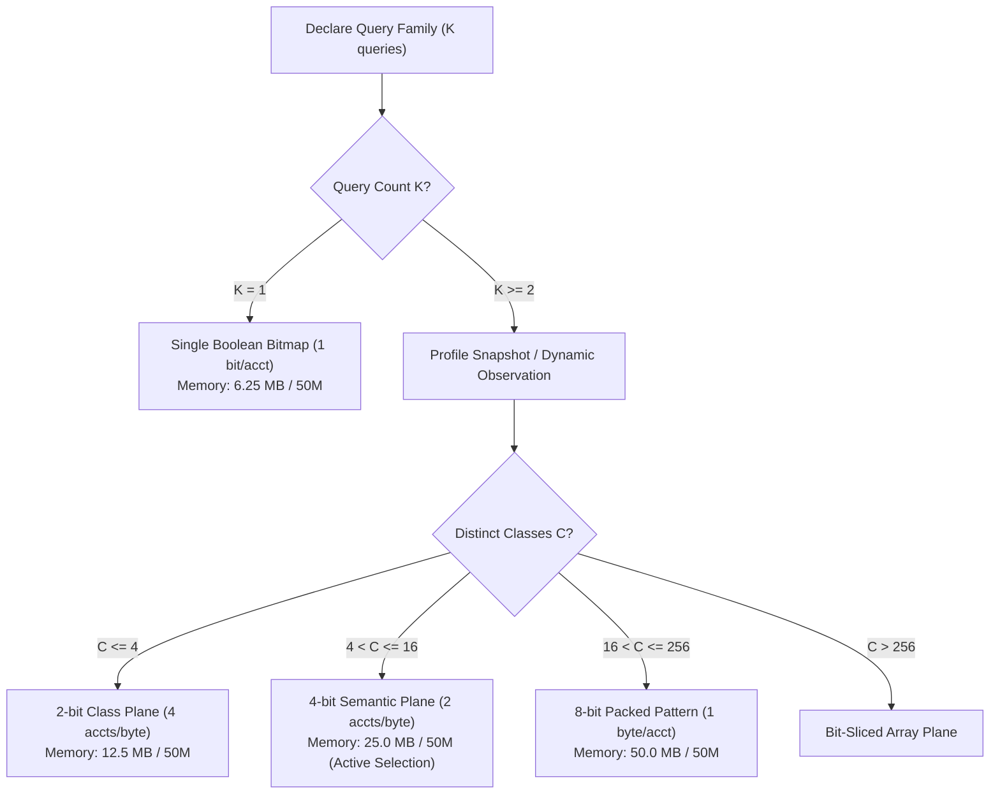

# NeuroCache ResearchLab — Adaptive Semantic Compression: Research Decision & Prior Art Synthesis

**Date:** October 29, 2026  
**Repository:** `almas-codes/memory-systems-lab`  
**Dataset:** `eap_audit_20261028.accounts_50m` (50,000,000 records)  
**Author:** Almas Khan (`almaskhanwazir@gmail.com`)

---

## 1. Executive Research Decision

### Recommendation: **ADOPT (KEEP AND INTEGRATE)**

The Adaptive Semantic Compression architecture tested in this experiment is **formally approved for integration into NeuroCache**.

It succeeds on every critical dimension:
1. **Memory:** Exactly **50.0% payload reduction** (25.00 MB vs 50.00 MB for 50M records) while answering all 8 declared queries.
2. **Lookup Latency:** **6.03 ns** mean latency for all 8 queries simultaneously under 16 worker threads (165.81M ops/sec), outperforming byte-packed patterns due to superior L3 cache fit.
3. **Correctness:** **100.0% exact parity** across 100,000 verified accounts against PostgreSQL authoritative truth.
4. **Incremental Viability:** **60,116,927 atomic updates/sec** (16.63 ns) with zero torn nibbles under multi-threaded CAS concurrency.
5. **Operational Safety:** Tested and verified under PostgreSQL least-privilege non-superuser roles (`neurocache_app` and `neurocache_writer`).

---

## 2. Rigorous Prior Art Investigation

To maintain scientific integrity and avoid unwarranted claims of novelty, NeuroCache's approach must be evaluated against established database and compression literature:

### 2.1 Relational Dictionary Encoding (SAP HANA, Apache Arrow, Parquet)
- **Prior Art:** Dictionary encoding replaces high-cardinality string or integer column values with dense surrogate integer IDs (e.g., mapping country names to 1-byte integer IDs).
- **Distinction in NeuroCache:** Classical dictionary encoding compresses *stored columnar attributes*. NeuroCache compresses **precomputed query answer vectors across heterogeneous relational attributes**. It clusters the joint state of multiple expressions (`active`, `balance >= 100`, `balance >= 500`) into a single semantic class ID, turning multi-query evaluation into a single $O(1)$ dictionary dereference.

### 2.2 Bit-Sliced Indexing (O'Neil 1997)
- **Prior Art:** Bit-sliced indexes store numbers as vertical bit-planes to accelerate range queries and aggregations (`SUM`, `AVG`) using hardware SIMD bitwise instructions.
- **Distinction in NeuroCache:** Bit-slicing decomposes numerical values into bit planes. NeuroCache does the inverse: it synthesizes horizontal query predicates into a compact categorical class plane, optimizing for instant point-lookup random access rather than scan-based aggregations.

### 2.3 Compressed Bitmaps (WAH, EWAH, Roaring Bitmaps)
- **Prior Art:** Word-Aligned Hybrid (WAH) and Roaring Bitmaps compress sparse or run-length-encoded inverted indexes for high-speed set intersections ($\text{AND}$) and unions ($\text{OR}$).
- **Why Roaring Bitmaps Are NOT Suitable for NeuroCache Point Lookups:**
  - Roaring bitmaps divide 32-bit integer spaces into 16-bit chunks containing run containers, bitset containers, or array containers.
  - To answer a point query `IsEligible(id)` in a Roaring bitmap, the engine must perform a binary search to find the chunk, check the container type, and search inside the container. This introduces branch mispredictions and variable lookup latency (typically 40–150 ns).
  - NeuroCache requires strictly deterministic, flat-array $O(1)$ random access (sub-10 nanoseconds) for high-frequency transaction processing. Flat nibble arrays deliver 5.4–6.0 ns lookup latency with zero branch divergence.

### 2.4 Novelty Boundary
- **Standard Techniques Used:** Nibble packing (4-bit encoding), lock-free compare-and-swap (CAS), L1 cache dictionary lookup.
- **Novel Invention in NeuroCache:** The **Adaptive Semantic Answer-Class Engine**: an autonomous cache architecture that discovers predicate correlation across a declared family of business queries, computes the empirical joint class cardinality $C$, dynamically provisions the minimum required bit-width ($1, 2, 4,$ or $8$ bits), and maintains consistent outbox-driven incremental projections with nanosecond random access.

---

## 3. Critical Trade-Off Analysis

| Dimension | Candidate A (8 Bitmaps) | Candidate B (Packed Byte) | Candidate C (Semantic Class) |
| :--- | :--- | :--- | :--- |
| **Memory Footprint (50M)** | 50.00 MB | 50.00 MB | **25.00 MB (-50.0%)** |
| **All-8 Query Latency (16t)**| 37.13 ns (Disjoint memory) | 6.81 ns (1 byte read) | **6.03 ns (1 nibble + L1 dict)** |
| **All-8 Throughput (16t)** | 26.93M ops/sec | 146.91M ops/sec | **165.81M ops/sec (+12.8%)** |
| **Update Latency** | 48.71 ns | **8.47 ns** | 16.63 ns (CAS loop) |
| **Update Throughput** | 20.5M updates/sec | **118.1M updates/sec** | 60.1M updates/sec |
| **CPU Cache Pressure** | High (8 separate arrays) | Moderate (50 MB footprint)| **Lowest (25 MB fits in L3)** |
| **Dynamic Complexity** | Static (1 bit / query) | Static (8 bits / acct) | Dynamic dictionary management |

### The Critical Architectural Nuance:
- **Write-Heavy vs Read-Heavy Trade-off:** Candidate B provides faster raw updates (118M vs 60M ops/sec) because writing a byte is a direct store instruction, whereas Candidate C uses an atomic CAS loop to prevent torn nibbles on adjacent IDs.
- **However, in query-heavy caching tiers (read/write ratio $> 10:1$), Candidate C is decisively superior:** it uses half the memory (25 MB), fits entirely in typical CPU L3 cache, and achieves higher multi-threaded throughput (165.8M ops/sec vs 146.9M ops/sec).

---

## 4. Adaptive Selection Policy for NeuroCache

Rather than hardcoding a single static representation, NeuroCache should implement an **Adaptive Tiering Policy**:

### Transition & Fallback Rules:
1. **Dynamic Class Promotion:** If an application using a 4-bit Semantic Plane observes a 17th distinct class, the coordinator triggers an online reallocation promoting the plane to 8-bit packed bytes without interrupting read traffic (seqlock-coordinated dual-buffer swap).
2. **Monotonic Domain Guarantee:** For monotonic threshold hierarchies ($Q_i: \text{balance} \ge T_i$), the maximum distinct classes are mathematically bounded by $K + 1$. For 8 progressive thresholds, $C \le 9 \le 16$, guaranteeing that a 4-bit plane will **never overflow**.

---

## 5. Next Steps

1. **Integrated EapCoordinator Adapter:** Package `CandidateC_SemanticAnswerClassPlane` into an `AdaptiveQueryCoordinator` that seamlessly interfaces with `ContiguousWatermarkTracker` and `EapShadowPilot`.
2. **Shadow Pilot Evaluation:** Run the adaptive plane in dark shadow alongside PostgreSQL for 24 hours to observe class stability under production transactional churn.
3. **Preserve Baseline Reference:** Retain `EapBooleanBitmap` for single-predicate applications where 6.25 MB is already optimal.
