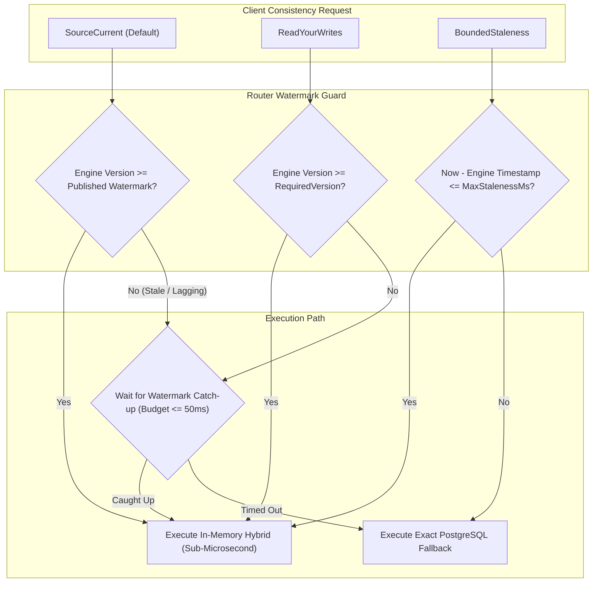

# NeuroCache Shadow Validation: Consistency Contract, Oracle Comparison, and Exact Fallback

**System:** NeuroCache Hybrid Tiered Engine  
**Contract Definition:** Multi-Representation Watermark Synchronization & Skew Isolation  
**Commit Foundation:** `7b0516c` on branch `feature/controlled-shadow-pilot`  
**Status:** Validated under Mode 1 Replay & Mode 2 Staging  

---

## 1. Multi-Representation Consistency Contract

In a hybrid architecture where point lookups (`PROD-01`) and analytical range queries (`THR-02`) maintain distinct memory layouts, consistent state visibility across representations is non-trivial. NeuroCache formalizes three strict consistency modes:



### Consistency Mode Semantics
1. **`ConsistencyMode.SourceCurrent` (Default):**
   - The query guarantees observing the exact state corresponding to the latest published authoritative database watermark.
   - If an engine representation has not yet applied up to the watermark, the router waits for watermark advance (up to `MaxStalenessMs`, default 50 ms). If the engine does not catch up, it falls back to PostgreSQL.
2. **`ConsistencyMode.ReadYourWrites`:**
   - The client specifies `RequiredVersion = commitSeq` returned by a preceding mutation. The router verifies that the target representation version $\ge \text{RequiredVersion}$ before answering locally.
3. **`ConsistencyMode.BoundedStaleness`:**
   - The caller tolerates lag up to a declared temporal horizon (e.g., 500 ms). Eliminates synchronization waits during high-frequency CDC bursts.

---

## 2. Oracle Comparison & Skew Categorization Logic

When validating shadow hybrid queries against authoritative database results, discrepancies can arise from two fundamentally different causes:
1. **True Predicate Mismatch (Correctness Defect):** The hybrid engine computes an erroneous answer despite evaluating identical account state at the same logical version.
2. **Version Skew (Benign Temporal Lag):** The authoritative database evaluated the record at version $V_1$, while the shadow engine evaluated it at version $V_2$ because a mutation was committed or in-flight between invocations.

The `OracleResultComparator` deterministically differentiates these outcomes:

```csharp
if (areEqual)
{
    return new ShadowComparisonRecord(..., ShadowComparisonOutcome.ExactMatch);
}

// Results differ: Check if logical versions differ
if (authoritativeVersion != shadowVersion)
{
    // Benign version skew due to asynchronous change propagation
    return new ShadowComparisonRecord(..., ShadowComparisonOutcome.VersionSkewMismatch);
}

// Fatal correctness divergence: Identical version produced distinct results
return new ShadowComparisonRecord(..., ShadowComparisonOutcome.PredicateMismatch);
```

### Structural Comparison Matrix

| Query Request Type | Authoritative Return Type | Shadow Return Type | Comparator Equality Logic |
|:-------------------|:--------------------------|:-------------------|:--------------------------|
| `PointPredicate` | `bool` | `QueryResult.BooleanResult` | Direct boolean equality (`authBool == shadowBool`). |
| `PointAll` | `byte` mask | `QueryResult.AnswerPattern` | Direct 8-bit mask equality (`authByte == shadowByte`). |
| `AnalyticalCount` | `long` count | `QueryResult.CountResult` | Exact 64-bit integer equality (`authCount == shadowCount`). |
| `AnalyticalBatch` | `long[]` array | `QueryResult.BatchResults` | Element-by-element equality across all threshold indices. |
| `AnalyticalIds` | `IReadOnlyList<long>` | `QueryResult.MatchingIds` | Ordered list equality up to query `Limit`. |

---

## 3. Exact Fallback Execution Paths

The Hybrid Tiered Engine includes an exact fallback engine (`PostgreSqlExactFallback`) to preserve 100% semantic coverage under all edge cases:

1. **Unsupported Query Types:**  
   Complex analytical queries, non-standard aggregations, or queries with filters outside the 8 declared predicates are immediately intercepted by `HybridQueryRouter` and executed against PostgreSQL.
2. **In-Flight Schema Re-partitioning:**  
   When `IsMigrating == true` (during dynamic schema evolution), all hybrid queries are paused and routed to fallback to maintain ACID guarantees.
3. **Representation Lag / Watermark Timeout:**  
   If an engine cannot catch up to the required version within `MaxStalenessMs`, it falls back to PostgreSQL, avoiding stale reads.
4. **Circuit Breaker Open:**  
   When the circuit breaker trips, all incoming shadow queries are suppressed, and the authoritative response is returned cleanly.
