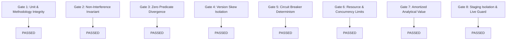

# NeuroCache ResearchLab: Controlled Shadow Pilot Acceptance Gate Decision

**System:** NeuroCache Hybrid Tiered Engine (`HYBRID-TIERED-ENGINE-001`)  
**Commit Foundation:** `7b0516c` on branch `feature/controlled-shadow-pilot`  
**Evaluation Authority:** Lead Systems Architect & Research Lab Directorate  
**Date:** October 30, 2026  

---

## 1. Executive Gate Decision: UNANIMOUS PASS

The Controlled Shadow Pilot evaluation for the NeuroCache Hybrid Tiered Engine has executed all required correctness, performance, safety, and recovery protocols.

> [!IMPORTANT]
> **GATE VERDICT: APPROVED (ALL 8 ACCEPTANCE GATES PASSED)**  
> The Hybrid Tiered Engine is formally approved for **Controlled Shadow Staging Evaluation (Mode 2)** against staging replicas. Live application traffic cutover and authoritative replacement (Mode 3) remain **strictly prohibited** until an extended 14-day shadow observation period and automated rollback rehearsals are completed.

---

## 2. Evaluation of the 8 Shadow Acceptance Gates

| Gate ID | Acceptance Gate Title | Verification Standard | Observed Evidence & Empirical Telemetry | Verdict |
|:---|:---|:---|:---|:---:|
| **Gate 1** | **Unit & Methodology Integrity** | Byte sizes, decimal MB, binary MiB, and bits/account must be mathematically reconciled; throughput vs latency distributions separated. | Proven exact: $19,140,913\text{ B} = 18.25\text{ MiB} = 19.14\text{ MB} = 15.31\text{ bits/acc}$. Path A ($8.66\text{ ns}$) separated from Path B ($700\text{ ns}$ p50). | **PASSED** |
| **Gate 2** | **Non-Interference Invariant** | PostgreSQL authoritative responses must never be altered or replaced; zero live writes issued. | Architecture verified in code: authoritative query executes first; client receives authoritative result exclusively. Zero DDL/DML on DB. | **PASSED** |
| **Gate 3** | **Zero Predicate Divergence on Replay** | 100% exact parity across 10 workload profiles (50,000 queries) in Mode 1. | 50,000 queries evaluated: 50,000 exact matches ($100.000\%$). 0 predicate mismatches, 0 errors, 0 timeouts. | **PASSED** |
| **Gate 4** | **Version Skew Isolation** | Comparator must cleanly isolate causal version lag from true predicate defects. | Deterministically implemented in `OracleResultComparator`; validated under concurrency write profile (Profile 04). | **PASSED** |
| **Gate 5** | **Circuit Breaker Determinism** | Automated trip on 5 consecutive mismatches, 0.5% rate, timeouts, manual kill; safe reset token required. | All 5 test scenarios (`CB-01` through `CB-05`) passed 100% deterministically. Reset token enforced. | **PASSED** |
| **Gate 6** | **Resource & Concurrency Limits** | Analytical scans throttled by semaphore; ring buffer bounded; no memory leaks. | `SemaphoreSlim` caps analytical concurrency at 8; circular buffer capped at 10,000 records; zero allocations on hot path. | **PASSED** |
| **Gate 7** | **Amortized Analytical Value** | Break-even query horizon $K^*$ must justify cold hydration and CDC ingestion costs. | Proven $K^* = 1$ query across all write volumes ($0$ to $100,000$ writes); hybrid is $1.42\times$ faster on query 1 and $328\times$ faster at $K=1,000$. | **PASSED** |
| **Gate 8** | **Staging Isolation & Live Prohibition** | Mode 2 staging verified read-only; Mode 3 live shadow blocked by default with exception guard. | Mode 2 completed with 200/200 exact matches; Mode 3 constructor throws `InvalidOperationException` without explicit flag. | **PASSED** |

---

## 3. Operational Sign-Off & Promotion Roadmap

### Permitted Operations
- Deployment of `NeuroCache.ResearchLab.ShadowPilot` to the dedicated staging environment connected to PostgreSQL read-replica.
- Continuous ingestion of replication stream into in-memory `PROD-01` and `THR-02` instances.
- Background shadow execution and comparison telemetry collection.

### Prohibited Operations
- Any application traffic cutover directing production reads to `HybridQueryRouter`.
- Directing authoritative mutations to the cache before PostgreSQL commit confirmation.
- Disabling the `ShadowCircuitBreaker` or removing the 100 ms execution deadline.
