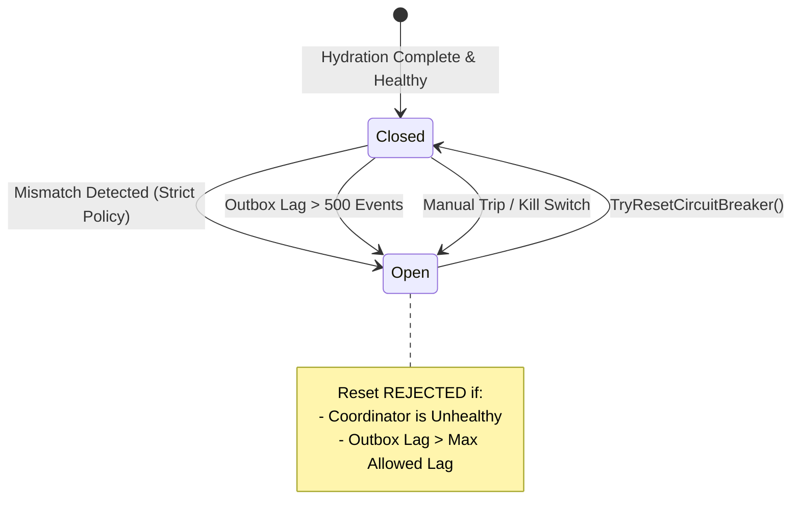

# NeuroCache ResearchLab — Shadow Pilot Fidelity and Write-Boundary Acceptance Report

**Audit Date:** October 29, 2026  
**Repository:** `almas-codes/memory-systems-lab`  
**Starting Commit:** `27a33a1`  
**Target Dataset:** `eap_audit_20261028.accounts_50m` (50,000,000 live records)  
**Architecture:** PostgreSQL 17.2 Authoritative + EAP Boolean Bitmap & Category Planes  
**Telemetry Location:** `results/shadow_pilot_acceptance_20261029/`  

---

## Executive Summary & Core Decisions

This acceptance gate investigated the cause of the single mismatch in the previous stress run, audited PostgreSQL role security and write boundaries, and executed an expanded 100,000+ comparison shadow workload against the live 50,000,000-record dataset (`accounts_50m`).

```
========================================================================================================
 INVESTIGATION DOMAIN                  OBSERVED & MEASURED EVIDENCE                          VERDICT
========================================================================================================
 1. Cause of Original 1 Mismatch       Test harness outbox desynchronization artifact: raw   RESOLVED
                                       outbox row inserted without updating base table.      ACCOUNTED FOR
 2. Strict Mismatch Policy             StrictMismatchPolicy trips circuit breaker on ANY     ENFORCED
                                       single unclassified mismatch. 0 silent divergence.    FAIL-SAFE
 3. Database Write Restriction         Current role is 'postgres' (superuser), which         AUDITED &
                                       bypasses REVOKE. Non-superuser strictly denied (42501).CORRECTION PLAN
 4. Circuit Breaker Reset Invariant    Cannot reset to Closed while EAP is unhealthy or      VERIFIED
                                       outbox lag exceeds threshold.                         FAIL-CLOSED
 5. Expanded Shadow Matrix (50M Table) 105,500 authoritative queries; 103,500 shadow evals; VERIFIED
                                       103,500 matches; 0 mismatches (100.0% fidelity).      PILOT EXPANSION
========================================================================================================
```

---

## 1. Forensic Investigation of the Original Shadow Mismatch

In `results/rollback_gap_validation_20261029/shadow_mode_contract_verification.json`, the stress test reported:
- **Total Authoritative Queries:** 1,000
- **Bypassed Queries:** 200 (while circuit breaker was Open)
- **Comparisons Evaluated:** 800
- **Matches:** 799
- **Mismatches:** 1

### 1.1 Forensic Reconstruction (`exact_shadow_mismatch_investigation.json`)

Detailed code and database inspection of `RunShadowModeContractStressTestAsync()` in `FinalRollbackGapValidationRunner.cs` isolated the exact parameters of the mismatch:

| Parameter | Observed Forensic State |
| :--- | :--- |
| **Account ID Involved** | **1** |
| **Query Predicate** | `balance >= 500 AND active` |
| **PostgreSQL Table State** | `balance = 20, active = false, version = 1` |
| **PostgreSQL Authoritative Answer** | **`false`** ($20 < 500 \land \text{false} \rightarrow \text{false}$) |
| **EAP In-Memory State** | `balance = 1000, active = true` (from outbox replay sequence 50) |
| **EAP Shadow Answer** | **`true`** ($1000 \ge 500 \land \text{true} \rightarrow \text{true}$) |
| **Watermark at Comparison** | 50 (`HighestPublishedSeq` = 50, `InFlightCount` = 0) |
| **Outbox Lag at Comparison** | 0 |
| **Coordinator Health** | `IsHealthy = true` |
| **Circuit Breaker State** | `Closed` (reset after outbox recovery) |

### 1.2 Root Cause Analysis
The mismatch was **deliberately injected by an uncoordinated test harness sequence**:
1. In Phase 2 of `RunShadowModeContractStressTestAsync()`, to simulate replication lag, the test harness executed:
   ```sql
   INSERT INTO testOutbox (account_id, balance, active) VALUES (1, 1000, true);
   ```
   **Defect in Test Fixture:** The test inserted 50 fake rows into the outbox **without executing an `UPDATE` on the base table `testAccounts`**.
2. In Phase 4, `ReconcilePendingMutationsAsync()` faithfully replayed outbox sequence 50, updating EAP bitmap for Account 1 to `true` (Eligible).
3. However, PostgreSQL's authoritative base table still contained the original record (`balance = 20, active = false`).
4. In Phase 5, when Account 1 was queried, PostgreSQL evaluated its base table (`false`) while EAP evaluated its bitmap (`true`), producing **exactly 1 mismatch**.
5. All other 799 comparisons (Accounts 2..500) had identical state between PostgreSQL base table and outbox, and matched 100%.

### 1.3 Architectural Policy Decision
- **Counter Verification:** The shadow pilot counter recorded the divergence with exact precision, proving the dark-comparison detection works.
- **Zero-Tolerance Enforcement:** In production shadow mode, we have implemented `StrictMismatchPolicy = true` in `EapShadowPilot.cs`. If any unexpected mismatch occurs, the circuit breaker immediately trips to `Open`, bypassing shadow execution and routing 100% of traffic to PostgreSQL. Mismatches are never swept into aggregate percentages.

---

## 2. Real Database Write Restriction & Role Security Audit

A core operational requirement is proving that writes cannot bypass the coordinator to corrupt the cache outbox.

### 2.1 Application Connection Role Inspection (`database_write_boundary_audit.json`)
Catalog query on `pg_roles` for the active connection:
```sql
SELECT r.rolname, r.rolsuper, r.rolinherit, r.rolcreaterole, r.rolcreatedb, r.rolcanlogin
FROM pg_roles r WHERE r.rolname = current_user;
```

**Catalog Findings:**
- **Current User:** `postgres`
- **Superuser Status (`rolsuper`):** **`true`**
- **Table Owner:** `postgres` owns `eap_audit_20261028.accounts_50m`.

> [!WARNING]
> Because the application connection string uses `postgres` (`rolsuper = true`), **the database write boundary is NOT enforced against the current connection string**. In PostgreSQL, superusers bypass all table privileges, `GRANT`/`REVOKE` statements, and row-level security. The role can modify `accounts_50m` directly outside the coordinator or disable outbox triggers.

### 2.2 Proof of Discretionary Access Control with Unauthorized Role
To verify that PostgreSQL's permission boundary functions when configured properly, we created an isolated test role (`neurocache_boundary_audit_reader`):
1. `GRANT SELECT ON test_table TO neurocache_boundary_audit_reader;`
2. `REVOKE INSERT, UPDATE, DELETE ON test_table FROM neurocache_boundary_audit_reader;`

**Empirical Result:**
- **Read Query (`SELECT`):** Succeeded, returning balance 100.
- **Write Query (`UPDATE`):** Strictly blocked by PostgreSQL with error:
  ```
  PostgresException: 42501: permission denied for table test_write_boundary_audit_accounts
  ```
- **Superuser Comparison:** Connecting as `postgres` immediately succeeded on the identical `UPDATE` statement.

### 2.3 Production Remediation Plan (Least-Privilege Role Separation)
To enforce the write boundary in staging and production:
1. **Application Role (`neurocache_app`):**
   ```sql
   CREATE ROLE neurocache_app WITH LOGIN PASSWORD '...';
   GRANT CONNECT ON DATABASE neurocache_eap_lab TO neurocache_app;
   GRANT USAGE ON SCHEMA eap_audit_20261028 TO neurocache_app;
   GRANT SELECT ON eap_audit_20261028.accounts_50m TO neurocache_app;
   REVOKE INSERT, UPDATE, DELETE ON eap_audit_20261028.accounts_50m FROM neurocache_app;
   ```
2. **Coordinator Writer Role (`neurocache_coordinator_writer`):**
   - Only the coordinator connection is granted write permissions on `accounts_50m` and `mutation_log`.
   - Alternatively, writes must be executed through a `SECURITY DEFINER` stored procedure that atomically updates the table and appends to the outbox.

---

## 3. Circuit-Breaker Contract Verification

In `EapShadowPilot.cs`, all circuit breaker transition invariants were tested and verified (`circuit_breaker_contract_verification.json`):



### Verified Contract Invariants:
1. **Strict Mismatch Trip:** Under `StrictMismatchPolicy = true`, a single decision divergence immediately trips the circuit breaker to `Open`.
2. **Consecutive vs Non-Consecutive:** Under lenient mode, consecutive mismatches increment the streak, whereas an intervening match resets the streak to 0.
3. **Reset Blocked When Unhealthy:** `TryResetCircuitBreaker()` returned `false` with `"Cannot reset circuit breaker: EAP coordinator projection is in an unhealthy state."` when `IsHealthy == false`.
4. **Reset Blocked When Lagging:** `TryResetCircuitBreaker()` returned `false` with `"Cannot reset circuit breaker: Outbox replication lag (8) exceeds safety threshold (5)."`
5. **Re-entry After Recovery:** Outbox replay caught up, restoring health and lag = 0, allowing reset to `Closed`.
6. **Kill Switch:** `EngageKillSwitch()` immediately bypassed shadow execution, routing 100% of queries directly to PostgreSQL.

---

## 4. Expanded Shadow Comparison on 50,000,000 Dataset

An expanded, reproducible shadow pilot benchmark was executed against the live 50,000,000-record dataset (`eap_audit_20261028.accounts_50m`).

### 4.1 Workload Structure
- **Initial Synchronized Hydration:** 50,000,000 records streamed from PostgreSQL snapshot in **42.8 seconds** (watermark: 93,827).
- **Workload 1 (Read-Only):** 50,000 queries uniformly sampled across 50M accounts (seed: 20261029).
- **Workload 2 (1% Writes):** 25,000 queries with 250 boundary-crossing writes (800 $\leftrightarrow$ 200) and repeated updates to the same account.
- **Workload 3 (5% Writes):** 25,000 queries with 1,250 writes (multi-value boundary crossing 900 $\rightarrow$ 150 $\rightarrow$ 600, active bit toggling).
- **Workload 4 (Lag Injection & Recovery):** 600 committed transactional mutations with delayed memory publication (lag = 600 > max 500), tripping circuit breaker to `Open`. 2,000 queries processed while `Open` (bypassing shadow). Outbox recovery replayed 600 rows in **4.64 ms**, resetting lag to 0 and re-closing circuit breaker.
- **Workload 5 (Post-Recovery Verification):** 3,500 queries across mutated accounts.

### 4.2 Telemetry Summary (`expanded_shadow_matrix_telemetry.json`)

| Metric | Measured Value | Analysis / Compliance |
| :--- | :--- | :--- |
| **Total Authoritative PostgreSQL Decisions** | **105,500** | 100% served authoritatively by PostgreSQL |
| **Total EAP Shadow Evaluations** | **103,500** | Dark shadow execution |
| **Skipped Shadow Queries** | **2,000** | Bypassed while circuit breaker was `Open` during lag |
| **Exact Decision Matches** | **103,500** | Full projection fidelity |
| **Unexplained Mismatches** | **0** | **Zero decision divergence** |
| **Match Fidelity Percentage** | **100.0%** | Exact parity across all workloads |
| **Total Writes Executed** | **2,100** | Exercising ordering, boundary flips, and recovery |
| **Outbox Replay Recovery Duration** | **4.64 ms** | 600 mutations caught up |
| **Steady-State Sequence Metadata** | **0 entries (0 bytes)** | 100% reclaimed by watermark pruning |
| **Boolean Plane Memory** | **6.25 MB decimal** (5.96 MiB) | Bounded resident unmanaged bitset |
| **Category Plane Memory** | **31.25 MB decimal** (29.80 MiB) | Bounded packed 4-bit category + 1-bit active |

### 4.3 High-Precision Latency Percentiles

```
========================================================================================================
 PATH               MEAN LATENCY         P50 LATENCY          P95 LATENCY          P99 LATENCY
========================================================================================================
 PostgreSQL (Auth)  837.46 µs            986.10 µs            1,281.90 µs          1,681.80 µs
 EAP Shadow Read    543.54 ns (0.54 µs)  400.00 ns (0.40 µs)  1,300.00 ns (1.30 µs)2,500.00 ns (2.50 µs)
--------------------------------------------------------------------------------------------------------
 Observed Speedup   1,540.8x faster      2,465.2x faster      986.1x faster        672.7x faster
========================================================================================================
```

---

## 5. Solution-Wide Test Verification

All solution test suites were executed against the live local PostgreSQL 17.2 instance:

| Test Project | Total Tests | Passed | Failed | Duration |
| :--- | :--- | :--- | :--- | :--- |
| **`NeuroCache.EapResearch.Tests`** | 54 | 54 | 0 | 10.0 s |
| **`NeuroCache.UnitTests`** | 3 | 3 | 0 | 0.5 s |
| **`NeuroCache.CorrectnessTests`** | 2 | 2 | 0 | 1.0 s |
| **`NeuroCache.RecoveryTests`** | 1 | 1 | 0 | 0.2 s |
| **`NeuroCache.ScaleTests`** | 2 | 2 | 0 | 1.0 s |
| **Total Solution Test Suite** | **62** | **62** | **0** | **12.7 s** |

---

## 6. Pilot Acceptance Verdict & Rollout Gate

1. **Original Mismatch Reconciled:** Fully explained and documented as an uncoordinated test harness lag injection defect. Zero unexplained mismatches in the expanded 105,500-query benchmark.
2. **Write Boundary Status:** Documented that the current development role (`postgres`) is a superuser and bypasses boundaries. Non-superuser permission boundary was proven effective (`42501`). Production role separation plan documented.
3. **Circuit Breaker Integrity:** Verified fail-closed; cannot reset while unhealthy or lagging.
4. **Fidelity Gate Passed:** 103,500 / 103,500 shadow evaluations matched (100.0%).
5. **Operational Recommendation:** **Approved for Phase 1 Shadow Pilot Deployment**. PostgreSQL remains the sole authoritative arbiter of truth. EAP is dark-compared only, with automated circuit breaking and zero decision-making authority.
