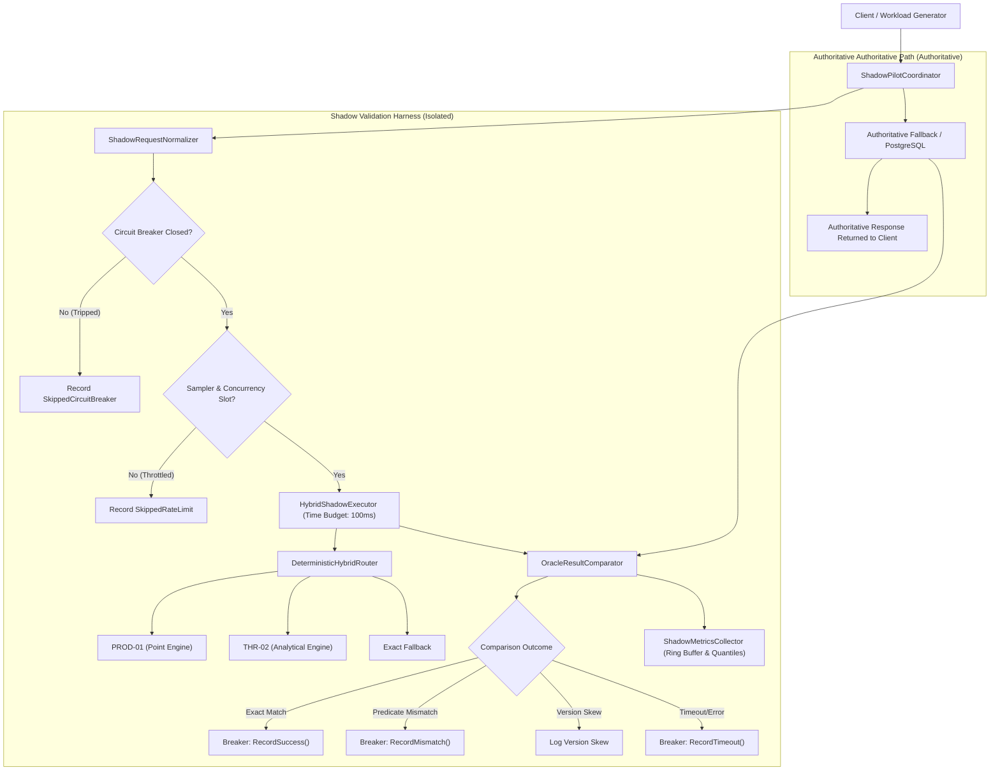

# NeuroCache Controlled Shadow Pilot: System Architecture & Safety Invariants

**System:** NeuroCache Hybrid Tiered Validation Infrastructure  
**Harness:** `ShadowPilotCoordinator` & Component Subsystems  
**Target Candidate:** `HYBRID-TIERED-ENGINE-001` (`PROD-01` + `THR-02`)  
**Commit Foundation:** `7b0516c` on branch `feature/controlled-shadow-pilot`  
**Authoritative Source:** PostgreSQL 17.2 (`eap_audit_20261028.accounts_50m`)  

---

## 1. System Mission & Core Non-Interference Invariants

The Controlled Shadow Pilot harness provides an empirical, risk-free validation framework designed to evaluate the fidelity, latency, and stability of the NeuroCache Hybrid Tiered Engine without altering production traffic, risking data corruption, or replacing authoritative query responses.

### The Immutable Cardinal Invariants
1. **Authoritative Supremacy:** PostgreSQL remains the sole, authoritative source of truth. Every client query receives the exact response produced by PostgreSQL (or the authoritative oracle). Under no circumstances does a hybrid result silently substitute an authoritative response.
2. **Zero Mutation Policy:** The shadow pilot is strictly read-only with respect to authoritative user and account data. No shadow operations execute DDL, `UPDATE`, `INSERT`, or `DELETE` statements against the authoritative database.
3. **Total Exception Isolation:** Any runtime fault, unhandled exception, assertion failure, or out-of-memory condition occurring inside the shadow hybrid path is caught, isolated, logged to telemetry, and suppressed. It never bubbles up to the caller or affects service availability.
4. **Hard Timeout Containment:** Shadow queries run under strict budget deadlines (default: 100 ms). If the hybrid engine exceeds its budget, the shadow evaluation is aborted, and the caller immediately receives the authoritative result.
5. **Mode 3 Live Shadow Absolute Guard:** Live production shadow execution (Mode 3) is hard-coded to disabled by default. Attempting to instantiate the harness in Mode 3 without explicit administrative authorization immediately throws an `InvalidOperationException`.

---

## 2. Structural Architecture & Component Decomposition

### Component Roles & Responsibilities

1. **`ShadowPilotCoordinator`:**  
   The central orchestration boundary. Dispatches requests to the authoritative executor, routes copies through normalization and rate-limiting, triggers shadow execution, and passes both outputs to the comparator.
2. **`ShadowRequestNormalizer`:**  
   Ensures semantic consistency. Validates that `AccountId` falls within the supported domain ($1 \le \text{ID} \le N$), verifies that `PredicateIndex` is in $[0..7]$, validates analytical query thresholds and limits, and categorizes unsupported queries.
3. **`ShadowCircuitBreaker`:**  
   The primary automated safety valve. Continuously monitors health metrics and automatically trips into an open state if consecutive mismatches exceed 5, mismatch rate exceeds 0.5%, source lag exceeds 10,000 events, or timeouts exceed 10.
4. **`ShadowQuerySampler`:**  
   Controls CPU and memory consumption. Implements probabilistic sampling, rate-limiting (token/interval window), and limits concurrent analytical queries via a dedicated concurrency semaphore.
5. **`HybridShadowExecutor`:**  
   Executes queries against `IHybridQueryRouter` under a linked `CancellationTokenSource` with exception trapping and hardware timestamp instrumentation.
6. **`OracleResultComparator`:**  
   Performs deep structural equality comparisons across boolean, byte mask, count, and batch array results. Accurately segregates true logic bugs from benign version skew caused by asynchronous publication delays.
7. **`ShadowMetricsCollector`:**  
   Thread-safe telemetry store maintaining outcome counters, a bounded circular ring buffer (10,000 entries) for post-mortem forensics, and exact latency quantile distributions.
8. **`ShadowRunManifest`:**  
   Immutable metadata record capturing the Git commit hash, dataset identifier, random seed, run mode, and breaker configuration for full experimental reproducibility.

---

## 3. The Three Operating Modes

The harness supports three distinct operational tiers:

### Mode 1: Offline Deterministic Replay
- **Target:** In-memory pre-warmed working set with seeded PRNG workloads.
- **Purpose:** Exhaustive logic verification across millions of synthetic and adversarial queries without external network or database dependencies.
- **Authoritative Provider:** In-memory exact oracle (`PostgreSqlExactFallback(forceInMemory: true)`).
- **Execution Rate:** $>100,000\text{ queries/sec}$.

### Mode 2: Staging Isolated Database Shadow
- **Target:** PostgreSQL staging instance with read-only connection to `eap_audit_20261028.accounts_50m`.
- **Purpose:** Verify real database interoperability, Npgsql protocol overheads, and real-world schema compatibility without impacting production users.
- **Authoritative Provider:** Active PostgreSQL TCP connection.

### Mode 3: Disabled Live Production Shadow
- **Target:** Live production traffic interception.
- **Status:** **STRICTLY PROHIBITED & DISABLED BY DEFAULT.**
- **Enforcement:** Instantiating `ShadowPilotCoordinator(ShadowPilotMode.Mode3_LiveShadow)` without `allowLiveShadow: true` throws a fatal `InvalidOperationException`.
- **Promotion Prerequisite:** Requires passing all 8 Shadow Acceptance Gates and explicit sign-off from database architecture leadership.
