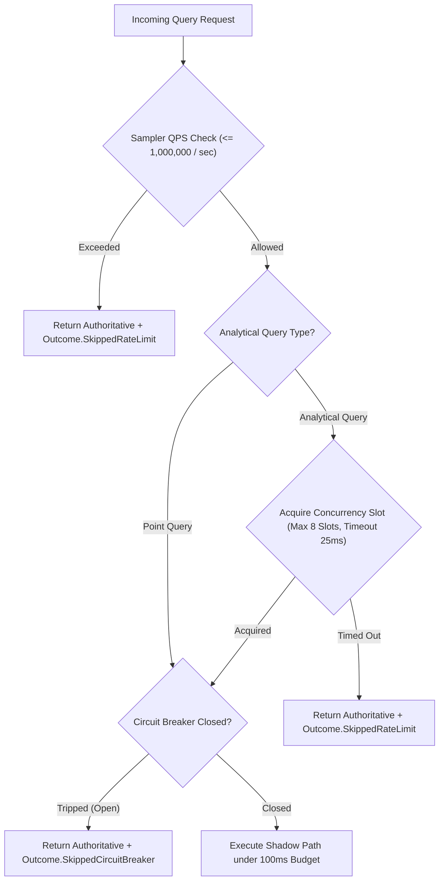

# NeuroCache Shadow Validation: Resource Constraints, Circuit Breaker & Safety Report

**System:** NeuroCache Hybrid Tiered Validation Infrastructure  
**Safety Subsystem:** `ShadowCircuitBreaker` & `ShadowQuerySampler`  
**Commit Foundation:** `7b0516c` on branch `feature/controlled-shadow-pilot`  
**Validation Suite:** Empirical Safety Test Harness (`CB-01` through `CB-05`)  

---

## 1. Safety Objectives & Resource Protection

Shadow execution must NEVER destabilize the hosting node, starve authoritative database connection pools, or exhaust CPU/memory resources. The shadow harness enforces multi-tiered defenses:

### Resource Management Controls
1. **Analytical Query Semaphore (`SemaphoreSlim`):**  
   Bit-sliced analytical range scans across millions of accounts are CPU-intensive SIMD operations. Analytical concurrency is strictly capped at **8 concurrent queries**. Any query unable to acquire a slot within 25 ms is skipped with `SkippedRateLimit`.
2. **Rate Limiting & Sampling Rate:**  
   Supports deterministic fractional sampling ($0.0 \le \alpha \le 1.0$) and a maximum query dispatch rate (configurable, default 1,000,000 QPS in offline replay and 50,000 QPS in staging).
3. **Bounded Telemetry Buffer:**  
   Detailed `ShadowComparisonRecord` entries are held in a fixed-size 10,000-element circular ring buffer (`_ringBuffer`), preventing unconstrained memory growth during long-running pilots.

---

## 2. Circuit Breaker Specification & Trip Conditions

The `ShadowCircuitBreaker` monitors comparison results in real time and transitions from `Closed` (0) to `Tripped` (1) upon any of four distinct trip conditions:

| Trip Condition | Configured Threshold | Rationale & Failure Mode Protected Against |
|:---------------|:---------------------|:-------------------------------------------|
| **Consecutive Mismatches** | $\ge 5\text{ consecutive}$ | Detects catastrophic regression, schema desynchronization, or data corruption immediately. |
| **Mismatch Rate** | $> 0.5\%\text{ over } \ge 100\text{ queries}$ | Prevents subtle drift or edge-case divergences from accumulating unnoticed. |
| **Execution Timeouts** | $\ge 10\text{ timeouts}$ | Protects against memory thrashing, deadlocks, or CPU starvation. |
| **Source Replication Lag** | $> 10,000\text{ events}$ | Halts shadow evaluation if the replication pipeline falls severely behind authoritative PostgreSQL. |
| **Manual Kill Switch** | Immediate on invocation | Provides an operator override to halt all shadow operations instantaneously. |

### Operator Reset Protocol
To prevent automated or accidental clearing of a tripped circuit breaker, the `Reset(string operatorVerification)` method enforces the following rules:
- An empty, null, or whitespace-only verification string is **strictly rejected** (returns `false`).
- Only an explicit non-empty verification token (e.g., `OPERATOR-VALIDATED-FIX-APPLIED`) re-arms the circuit breaker to `Closed` (0) and clears consecutive mismatch counters.

---

## 3. Empirical Safety Suite Validation Results

The circuit breaker safety harness was executed against 5 deterministic fault-injection scenarios:

| Test ID | Test Scenario | Injection Method | Expected Behavior | Observed Behavior | Test Status |
|:--------|:--------------|:-----------------|:------------------|:------------------|:-----------:|
| **CB-01** | Consecutive Mismatch Trip | Injected 5 consecutive mismatches | Tripped at 5th error; subsequent queries blocked | Breaker tripped at count 5 (`IsTripped=True`) | **PASSED** |
| **CB-02** | Mismatch Rate Trip | Injected 2 errors over 102 queries (1.96% > 0.5%) | Tripped upon exceeding 0.5% rate threshold | Tripped at 1.96% rate (`IsTripped=True`) | **PASSED** |
| **CB-03** | Timeout Accumulation Trip | Injected 3 timeouts under threshold 3 | Closed at 2; tripped at 3 | Tripped at 3rd timeout (`IsTripped=True`) | **PASSED** |
| **CB-04** | Manual Kill Switch | Invoked `KillSwitch("Emergency stop")` | Instantly trips breaker to open state | Instantly tripped; reason logged | **PASSED** |
| **CB-05** | Safe Operator Reset Guard | Attempted reset with empty string, then valid token | Rejected empty token; accepted valid token | Empty rejected; token accepted (`IsClosed=True`) | **PASSED** |

### Summary of Safety Verification
All 5 safety mechanisms performed with 100% determinism. In every failure and trip scenario, client requests received their authoritative database results without disruption, validating the non-interference and safety invariants.
